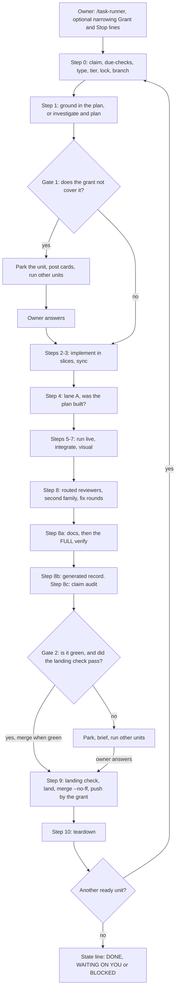
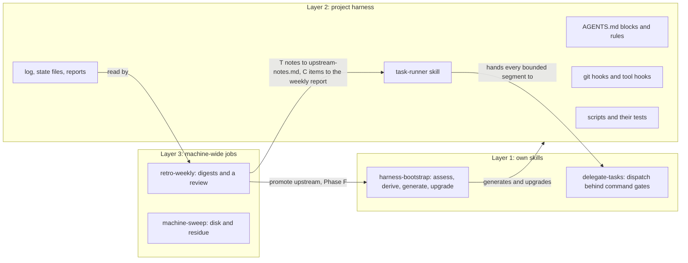
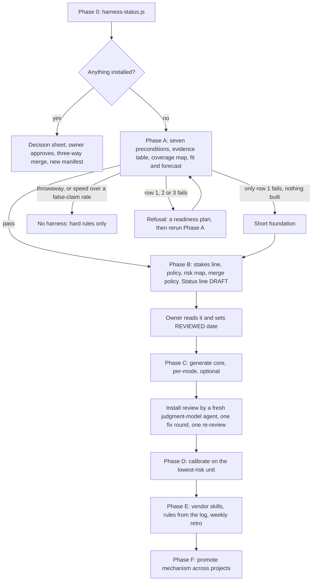
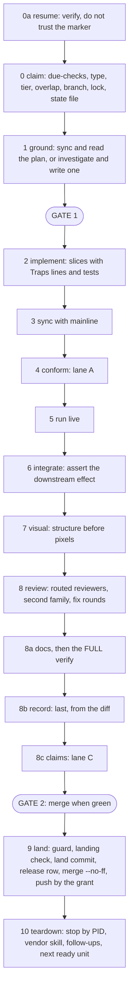
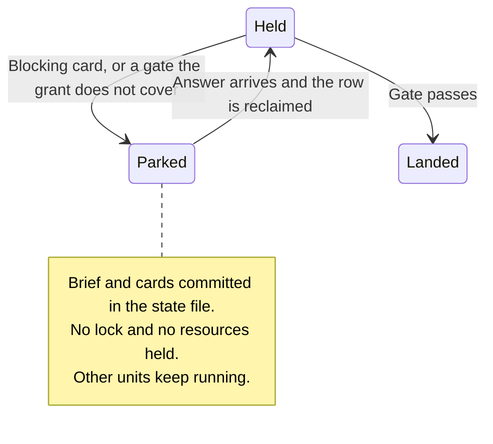

# The gated agent harness

**Describes:** skills `version: 12`, plugin `2.2.3-js.15`, branch `slim/harness-js15`, 2026-11-14.
`tests/fork/harness-doc.test.js` fails when the skills' version moves on without this file. A
plugin build that changes other things needs no edit here, so the build above can trail the
plugin's current one.

This document owns the **why, the flow and the analysis**. The references under
[`skills/harness-bootstrap/reference/`](../skills/harness-bootstrap/reference/) own
thresholds, cadences and exact wording, so it links to them instead of copying them. When
this document and a reference disagree on a threshold, the reference wins, and the
disagreement is a bug here.

**Where to start:** [§2](#2-one-page) for what it is, [§7](#7-how-a-run-works) for how a
run goes, [§18](#18-analysis-does-it-pay-for-itself) for whether it pays for itself,
[§19](#19-open-issues) for what is known to be wrong.

**How to read the numbers.** The evidence comes from the repositories that run the harness,
and those repositories are not named here. Each figure carries one of these labels and a date
or window:

| Label | Meaning |
|---|---|
| **measured** | Computed by a script from transcripts, git or usage records |
| **self-reported** | Written by a project's own harness log or report; not independently checked |
| **classified** | A model or a regex assigned the category; the count depends on that classifier |
| **estimate** | Modelled or projected; never observed as a result |

Dollar figures are API-list equivalents, not invoices: useful for ranking causes. They leave
out compaction calls and a few small items, so they are a floor. Where two sources disagree,
this document prints both ([§19](#numbers-that-do-not-agree)).

## Contents

1. [Terms first](#1-terms-first)
2. [One page](#2-one-page)
3. [Why it exists and how it started](#3-why-it-exists-and-how-it-started)
4. [Architecture](#4-architecture)
5. [Bootstrap and upgrade](#5-bootstrap-and-upgrade)
6. [What gets installed](#6-what-gets-installed)
7. [How a run works](#7-how-a-run-works)
8. [The human gates](#8-the-human-gates)
9. [Review and verification](#9-review-and-verification)
10. [Models and hosts](#10-models-and-hosts)
11. [`delegate-tasks`](#11-delegate-tasks)
12. [Context](#12-context)
13. [Guards, merge and push](#13-guards-merge-and-push)
14. [Measurement and learning](#14-measurement-and-learning)
15. [Inventory](#15-inventory)
16. [Distribution and rollout](#16-distribution-and-rollout)
17. [Version history](#17-version-history)
18. [Analysis: does it pay for itself?](#18-analysis-does-it-pay-for-itself)
19. [Open issues](#19-open-issues)

Appendices: [A, the rules](#appendix-a-the-rules-one-line-each) · [B, commands](#appendix-b-commands) · [C, test map](#appendix-c-test-map) · [D, reference-file map](#appendix-d-reference-file-map) · [E, sources](#appendix-e-sources)

## 1. Terms first

Several words here mean something else elsewhere, and the collisions cause real confusion.

| Term | Meaning here |
|---|---|
| **Gated harness**, "the harness" | Instructions, scripts and hooks generated into one repository. They make coding agents run each piece of work through numbered steps, with independent checks and human decision points |
| **Host** | The coding-agent program: Claude Code, Codex, ZCode or Kimi. ECC's own docs call these "harnesses"; this document never does |
| **Owner** | The human who decides product questions and one-way doors |
| **Unit** | One piece of work with a claim, a branch and a land: a plan row, a change, or a harness job |
| **Plan mode**, **change mode** | The two ways units arise. Plan mode takes rows with stable ids from a plan. Change mode takes change requests, issues or nothing yet, and picks a type and a tier. Neither is Claude Code's plan mode (`ExitPlanMode`), which the harness only uses as one way to show a plan |
| **Type** | What a task is: Ops, Answer, Intake, Docs-light, Docs-heavy or Code |
| **Tier** | How much process a Code unit gets: Trivial, Small or Full |
| **Slice** | The part of a unit handed to one executor |
| **Deliverable** | What the owner can open and check, named on a `Demo:` line. A unit may carry several, one at a time |
| **Gate** | Three meanings. **Gate 1 and Gate 2** are the human decision points. The **`Gate` column** of a slicing table is the command that decides whether a slice passed. The **run gates** are the commands `run-gates.sh` runs for verification. Unqualified, this document means the human ones |
| **Lane** | An independent audit: A plan conformance, B blast radius, C claims |
| **Family** | A model vendor. The **second family** is the one that did not write the code, and reviews it. Each host also has a **judgment model** and a **bounded model** |
| **Critical code**, **cold code** | Paths in a project's risk map where a miss cannot be corrected forward, and paths where it can |
| **Never-auto** | Categories the owner always approves, from the project's reviewed policy |
| **Registry** | `.claude/registry.md`, a gitignored table that is the lock: one row per held unit, and a table of parked ones |
| **State file** | `docs/plans/<unit>.state.md`, committed, at most 8 KB: where a unit resumes from |
| **Ledger** | The state file's table of steps: ran, skipped, unavailable or degraded. A step missing from it did not run |
| **Parked** | A unit waiting on the owner with no lock held, so that other units can run |
| **Standing grant** | A line in the project's `merge` block that approves, for every run, what the owner would otherwise approve unread: merge when green, push after merge, the recommendation on reversible cards. A kickoff may only narrow it |
| **`[M]`, `[B]`** | Reference-file markers. `[M]` mechanism ships as written. `[B]` binding is filled in per project |

**Not to be confused with** these ECC items, which share the word and do different jobs:

| ECC item | What it does | Relation to this harness |
|---|---|---|
| `harness-audit` (command) | Scores a repository's agent setup, deterministically | Separate; the skill's description sends config tuning there |
| `harness-optimizer` (agent) | Tunes local agent configuration with eval grading | Unused |
| `agent-harness-construction` (skill) | Designs agent action spaces and tool definitions | Unused |
| `autonomous-agent-harness` (skill) | Turns Claude Code into an autonomous system with queues and scheduling | Unused, and the opposite premise: this one is gated, not autonomous |
| `eval-harness` (skill) | Eval-driven development with pass rates | Unused |
| `gan-style-harness` (skill) | A generator and an evaluator loop | Unused; its "evaluator that loops until a score" is not how this harness decides |

## 2. One page

A gated harness makes coding agents take every piece of work through the same numbered steps,
with independent checks, and with two points where a human decides. The
[`harness-bootstrap`](../skills/harness-bootstrap/SKILL.md) skill generates it into each
repository, and from then on it belongs to that repository. Its other half,
[`delegate-tasks`](../skills/delegate-tasks/SKILL.md), hands well-specified pieces of work
to cheaper or different models behind checks that are commands, not reports.



**The owner does:** write and review the never-auto policy and the standing grant once; answer
blocking cards, which are the never-auto list and the owner's own facts; read the digest; approve
Ops steps, a deploying push included, and a landing the check sends to the owner, each with one key
press ([§8](#the-standing-grant)).

**The design says the owner no longer does:** approve steps or merges, manage the context, restart
sessions, ask what is next, or answer technical questions. These are the aims of v8 to v12, and
no install runs all of them yet: five run v9, none v10 or later ([§16](#install-state-2026-11-10)).

**v11 in one line:** the owner is asked last and once, and the machine cleans up after itself
instead of warning ([§3](#the-arc-of-the-versions)).

**v12 in one line:** pay only for the steps that find things, keep the evidence that says which
ones do, and give big work a controller session instead of the owner relaying by hand.

**What it is not:**

- **Not autonomous.** The phrase in the references is "gated, not autonomous".
- **Not a judge of whether the work is right.** No step decides that. Product judgment stays
  at the gates.
- **Not a shared runtime.** Each project owns its copy, and an upgrade is a reviewed merge.
- **Not free.** Costs and defects of the harness itself are in [§18](#costs).

## 3. Why it exists and how it started

### The failures that forced it

Agents reported work as done that was not. Tests passed without testing. Reviews approved what
they had not read. Each of these happened in a real project before any rule existed, and every
figure below is **self-reported** by that project's log unless marked.

| What happened | Evidence |
|---|---|
| False claims shipped in records | 9 of the first 21 tasks shipped at least one false claim; one shipped 8 |
| A conformance check is not a correctness check | Conformance read `CLEAN` on `CRITICAL` findings nine tasks running |
| Another session's work got swept into a commit | `git add -A` took 588 lines of another session's work |
| Green suite that tested nothing | A validation passed while skipping all eleven of its live cases |
| "Done" reports could not be trusted | Of 88 audited "done" reports, a cross-check found something in 87 and contradicted 81 |
| Sessions ended in hand-offs | 28 of 118 sessions, about 90% forced by a "start a new session" rule the harness itself had |
| Owner decisions spread thin | One change request carried 28 questions and then 16 more, over five owner rounds; one 45.7-hour stretch ran with no session at all, waiting on the owner and on a second family that was out |

### Two lineages, one skill

The harness was not designed in one sitting. Two projects grew their own answers.

- **Plan-mode lineage.** A regulated rental platform scaffolded a task runner over a plan with
  stable ids on 2026-09-06. A multi-tenant agent platform adopted it on 2026-10-02. It brought
  the registry lock, the commit guard, two gates, two auditors and the log.
- **Change-mode lineage.** A production multi-tenant platform, about 120 sessions in, grew task
  types, tiers and a review gate. Its earliest tier table dates from 2026-04-23 at the latest,
  it was formalised on 2026-09-25, and its review gate came on 2026-10-19.

On 2026-10-09, three diverging copies were ported into `harness-bootstrap` v1, plan mode only.
On 2026-10-19, v2 generalised change mode beside it, with an upgrade path, because repositories
were refusing the install and installs carried no version stamp. The owner rejected a
from-scratch orchestration design at that point and reused `delegate-tasks` instead.

### Why a generator, not a shared runtime

- **Critical paths and gate commands differ per project**, and the risky part cannot be
  templated. Phase B's policy is the piece "that cannot be templated".
- **Thresholds imported from another project hand a team rules whose reasons they have not
  lived.** So the never-auto categories, risk map, tripwire numbers and medians ship empty,
  to be earned.
- **Each project can edit its copy.** A manifest records what was edited, and an upgrade keeps
  those edits.
- **No dependency on ECC's plugin hooks.** The harness depends on git hooks and its own
  project-local hooks only, so plugin hook changes cannot silently remove a guard.

### The arc of the versions

Each round followed measurement of the last one ([§17](#17-version-history)):

1. **v1–v2, correctness:** make false reports hard to ship.
2. **v3–v5, cost and measurement:** a 14-day usage study priced the reviews and rerouted them;
   v5 added step markers and a weekly retro so that the next round would not need a study.
3. **v6, the harness's own defects:** about 95 distinct template defects found in four rollouts.
4. **v7, judgment:** decision-first planning, plan critique, a simplicity lens.
5. **v8, owner flow:** the run continues without the owner wherever it can.
6. **v9, fit:** the process scales to the stakes, and a documents-only start reaches product
   code in its first unit.
7. **v10, subtraction:** the owner waits only where they must decide, and product code comes
   first ([§18](#the-v10-study-2026-11-09)).
8. **v11, asked last, cleaned up:** one key press for an owner landing, the run's asks at its end,
   product units before harness units, and orphaned shells reaped instead of reported.
9. **v12, pay for what finds:** a 10-day study of 14 installs priced each step by what it found;
   re-reviews of P2-only fixes, the Sonnet reviewer, the claim audit on Small and known reds stop
   costing a step, verdicts are kept so the next cut is measured, and the own skill
   `coordinate-sessions` runs worker sessions behind one controller.

## 4. Architecture



The plugin ships layer 1. Layer 2 is generated into each repository, which then owns it, and upgrades
reach it through a manifest.

**Mechanism and binding.** Every reference marks its content `[M]`, copied as written, or `[B]`,
filled in for the project. A binding is what makes a rule true here: `CRITICAL` paths, the
gate commands, `ID_PATTERN`, the cadences. Tests check that the mechanisms still work after
binding ([Appendix C](#appendix-c-test-map)).

**Who orchestrates.** The generated runner skill holds the sequence, and the main session on the
judgment model coordinates it. The runner is stateless: everything it needs is in the registry
row and the state file, so any session can pick up cold. The main session owns tier, gates, plan
text, slicing, every brief, critique of reports, triage, scope guard, decision log, commits and
merge. Above Small, it writes no feature code and reads no file whole.

No single engine runs all of it, on purpose: the gates need the owner, and a workflow can neither
ask the owner nor run a command.

### What code enforces, and what only instructions ask

This table matters more than any other for judging the harness. A rule in the right-hand part
holds only as well as the model follows it.

| Rule | How it holds | Limit |
|---|---|---|
| No commit on a task branch without a row; no commit by a non-owner of a locked checkout; no merge of a branch that holds a row | **Refused** by `harness-guard.sh` in git hooks, for agents and humans | A fresh or moved clone is unguarded until `core.hooksPath` is set to the absolute hooks path and the registry is recreated |
| No `--no-verify`, no hook-path override, no force-push or delete of mainline, no backgrounded Codex run, no background wait without a bound | **Refused** by `command-guard.mjs` on PreToolUse | Fails open if the guard itself errors ([§19](#verified-disagreements-in-the-skills)) |
| No agent edit of env files or installed packages | **Refused** by `edit-guard.mjs` | Tool edits only; a shell command is not an edit |
| No FULL verify in a subagent or a wrapped run | **Refused** by `command-guard.mjs` (`agent_id` set) and by `run-gates.sh` under `HARNESS_ROLE=executor` | A hand-started shell with neither is not seen |
| A test gate fails on any skip, zero tests, or a count below the minimum | **Refused** by `run-counted.mjs` through `run-gates.sh` | Only for gates bound through it |
| The lane A and lane B agents cannot edit | **Refused** by the host through `tools:` frontmatter | On Claude Code. A Codex TOML cannot bound its sandbox, and the claim auditor has Bash on purpose |
| The second-family review is read-only | **Refused** by the wrapper's sandbox or restricted argv | Applies only when run through the wrapper |
| Links and paths alive, no secrets, no file over a host's hard read limit | **Refused** by `check-agent-docs.mjs`, run as a gate | Only when the gate runs. Size budgets warn and never fail |
| The critical content merged is content a cross-family review read | **Refused** by the commit, merge and ref hooks, through the mainline's committed `review-gate.mjs --landing` | Not a branch that edits the hook itself, nor a remote mainline ref moved by hand ([§9](#the-landing-check)); `HARNESS_LANDING=owner` overrides, as the owner key ([§13](#13-guards-merge-and-push)) |
| Git-derived record fields true by construction | **Generated** by `unit-record.mjs` from git | Its ledger and findings rows are copied as the session wrote them, and the prose beside them is still written |
| Which reviewers a diff is owed | **Computed** by `review-gate.mjs` | It prints a decision; the model has to dispatch them |
| A step ran | **Recorded** by `unit-step.mjs`, and it refuses a wrong checkout | Nothing forces the marker or the order |
| Stop on the never-auto list | **Instruction only** | The row is released before the merge, so no guard knows whether the owner agreed |
| Push only by the grant | **Instruction only**, except a deploying push, which the command guard turns into an owner prompt | No guard refuses any other plain `git push` |
| Decision classes, tier choice, "ask only what only the owner can decide" | **Instruction only** | The re-tier checks at both gates are also instructions |
| What the grant covers and how far | **Instruction only** | The grant sits in `AGENTS.md`, a narrowing and a stop line in the state file |
| Main session reads little and writes no feature code | **Instruction only** | The budget hook shows the figure and blocks nothing |

## 5. Bootstrap and upgrade

The skill runs in phases. Phase 0 and Phase A only read. Phase B writes an uncommitted draft
policy and stops, and nothing is generated until the owner has reviewed it.



### Phase A: assess, and be willing to refuse

| # | Precondition | If absent |
|---|---|---|
| 1 | A **pass signal** that can fail: at least one real test, run once and seen red once | Stop. "Done" would be unfalsifiable |
| 2 | A reachable **owner** who answers gates | Stop. Gates with nobody behind them are decoration |
| 3 | **Non-trivial work** | Stop. The harness would cost more than it catches |
| 4 | A **unit of work** | Routes to plan mode or change mode, never stops |
| 5 | A **risk signal** | Phase B derives the risk map |
| 6 | A **written** never-auto policy | Phase B derives it. This is the usual gap |
| 7 | The **stakes**: data, exposure, who runs it, what cannot be corrected forward | Ask the owner. It scales every review |

**Fit and forecast** come before anything is installed. The stakes line is weighed against
what the harness costs; a throwaway repository gets hard rules only. The plan's rows are
classified by tier, and each tier gets a cost range from the owner's other harness logs
(`estimate.mjs --log <a> --log <b>`), labelled *estimate*. The owner sees the gates and the
cost before the first unit, not after the fifteenth.

Lint, a type check and a format check are gates, not a pass signal. A command that runs nothing
is not a pass signal either. The output is a table with cited evidence and a coverage map per
path, and a unit that touches a path nothing covers is Full and never auto-merges.

**A refusal is a readiness plan,** written in the report and not the repository: the smallest
units that would make the failed rows pass, each with a "Done when", ending with *rerun Phase A*.

**The foundation stage** ([`reference/foundation.md`](../skills/harness-bootstrap/reference/foundation.md))
exists because of an embarrassment. One documents-only repository was refused, and then landed
three units in eleven minutes with no lock, no gate, no review and no log row (self-reported).
The foundation stage installs everything that needs no pass signal. Since v9 it is **short**:
the skeleton, the plan's first row, is the pass-signal unit, Full and owner-merged (until the
flip no gate counts a product test, so nothing has a pass signal to merge on), its "Done when"
one counted product test; the flip follows at once and takes the risk-map re-derive with
it, and no other harness unit runs first. v8 let an install name a later row the pass-signal
unit, and one did: row fifteen, reached after eight units in 29 hours, seven of them on the
harness itself ([§18](#a-documents-only-start-on-v7)).

### Phase B: the one piece that cannot be templated

[`reference/policy-derivation.md`](../skills/harness-bootstrap/reference/policy-derivation.md)
holds a single test: *if this is wrong and ships, can it be corrected forward?* The same test
yields three things: the never-auto policy, the risk map (hot, critical and cold modules, each
citing evidence), and the merge policy. The test is asked against Phase A's stakes line, which
opens the policy block, and since v9 every critical entry cites a harm under it or a never-auto
category; a coverage target or an importer count alone makes a path standard or hot, never
critical. The stakes line also carries `production: none | live`, which scales the review
lineup ([§7](#what-each-tier-runs)). All three go into the harness file under one line:

```text
Never-auto policy: DRAFT — owner has not reviewed
```

The skill does not commit this, and stops. The owner reads it and changes the line to
`REVIEWED <date>`. Phase C refuses while the line says `DRAFT`, because a policy adopted without
being read is not a policy.

### Phase C: generate

The core goes into every install, the per-mode binding follows, and each optional part is asked
about. [§6](#6-what-gets-installed) lists them. The project's own names win: where its documents
define agent roles and working rules, the generated files use those names. Project rules may
tighten the defaults and may never loosen them.

Then a **fresh agent on the judgment model reviews the install**, with one fix round and one
re-review. All four recorded install reviews found at least one P1 (self-reported; a total of 1
P0 and 10 P1, the P0 being a guard that let an unclaimed branch commit). The install lands as a
harness unit, registers for the weekly job, and offers the machine sweep.

### Phase D and on

- **Phase D** calibrates on one lowest-risk unit. The first failure writes the first rule. A fresh
  agent then reviews the generated harness against `rules.md` (ECC's `loop-design-check`, where
  installed) before the second unit. The skill says to expect being wrong: about 15 corrections in the origin's first 21 tasks, and
  roughly one reasoned rule in five later disproved ([§18](#rules-that-turned-out-wrong)).
- **Phase E** adds vendor-trap skills when a library behaves against its docs and the run
  measured it, adds rules from the log, and runs the weekly retro.
- **Phase F** promotes across projects: mechanism travels, thresholds never do.

### Left empty, to be earned

Never-auto categories and the risk map (Phase B derives them), the importer threshold, the
Hot-small tier, tripwire numbers and medians. The milestone cap starts at 15 slices or 10k
changed production lines, and the log moves it. Budgets on instruction files ratchet from their
current size. The model split is the deliberate exception, because it is mechanism: the judgment
model where a miss cannot be corrected forward.

### Upgrading an install

[`reference/upgrade.md`](../skills/harness-bootstrap/reference/upgrade.md) is the procedure.

1. **`harness-status.js`** reads the repository: lineage, each manifest entry's status, markers,
   sizes, held rows, the policy line and hazards by id. It writes nothing.
2. **A decision sheet** goes to the owner before anything is written:
   `Path[#block] | Lineage | Status | Proposed | Default`. Unchanged generated entries default to
   replace; edited, reviewed, scaffold and legacy entries default to keep; every hazard gets a row.
3. **Apply while no row is held or parked,** on a `harness/<slug>` branch. Template-backed entries
   merge three-way against the version that generated them; `--base <path>[#block]` supplies an
   older template and `--history <full clone>` its source. Skipping versions is one sheet, not a
   chain. Each upgrade ends with an install review.

The manifest, `.agents/harness-manifest.json`, is written last and has these kinds:

| Kind | Upgrade behaviour |
|---|---|
| `generated` | Replaced while its hash still matches |
| `scaffold` | Gains structure, never rows |
| `reviewed` | Changes only with the owner |

**Never install alongside.** An existing runner keeps its name through the manifest's `roles`,
since two files governing the same steps is the drift the rules warn about.

**The v8 and v9 upgrades** are in `reference/upgrade.md`: v8 added the session-resume hook, the
parked table and the `gates` block's proposals; v9 moved the run's blocks into `process.md` and
asked three cards (the stakes line, critical entries that cite no harm, the pass-signal unit).

**The v10 upgrade** is one unit, owner-merged: it rewrites the guards and the rules block. Its sheet
holds three cards: the `Grant:` line with `Push deploys:`; `production: none | live` with its
evidence; and the critical entries to demote plus the gates to add. It regenerates the rules block,
the runner and every script v10 changed, and marks open P3 rows outside any diff dropped. From v7 or
older, rows 8 to 10 go together, and only after the pilot.

**The upgrade cadence.** An install upgrades only between units, and only when a defect in its
version costs product work or the owner asks; a new version alone is not a reason. A version with an
owner card is piloted on two installs before any other; one without goes to every install the owner
names (v11 went to all of them). Since v11 there is no fixed pace: the owner chose no freeze, so each
version is built to cost an install nothing.

**The kickoff.** An upgrade starts from a prompt in a fresh session, between units, in this form:

```text
Use the harness-bootstrap skill to upgrade this repository's harness to v11,
following reference/upgrade.md. Confirm SKILL.md says version: 11. Start between
units, on branch harness/v11. Run harness-status first and show me the decision sheet.
```

## 6. What gets installed

Everything below is generated into the project. `*` marks an optional part, asked about at
install ([`SKILL.md`](../skills/harness-bootstrap/SKILL.md) › Phase C has the full table).

```text
AGENTS.md                 rules, stakes and policy, risk map, merge and standing grant, commands, the run pointer, plus the project's text
CLAUDE.md                 line 1 is @AGENTS.md, then Claude specifics only
CODEOWNERS                never-auto paths as required review, where the platform supports it
.githooks/                pre-commit, pre-merge-commit and reference-transaction, the same guard script
.claude/
  registry.md             the lock; gitignored
  settings.json           hook entries
  hooks/                  command-guard, edit-guard, leftover-processes, context-budget*, session-resume*
  agents/                 implementer, plan-conformance-auditor, blast-radius-auditor, claim-auditor
  skills/task-runner      committed relative symlink to the runner
  workflows/              review.workflow.js*
  rules/<area>.md         the project's path-scoped rules
.agents/
  skills/task-runner/SKILL.md     the runner, bound to this project's documents
  skills/task-runner/process.md   the run's blocks: types, tiers, gates, stops, scope, context, triggers, models
  harness-manifest.json           every entry's kind and hashes; written last
  harness-models.json             each role's model per host
.codex/                   agents/<name>.toml and hooks.json, where Codex is a target
.zcode/config.json        where ZCode is a target
docs/harness/
  log.md                  one row per unit: "the engine"
  rule-origins.md         the incident behind each shipped rule
  follow-ups.md           the register of deferred work
  upstream-notes.md       one line per harness finding, read at the next skill round; not a queue
  reports/                preflight, sweep, retro and hygiene reports
docs/plans/               <unit>.md, <unit>.state.md, <unit>.steps.jsonl, decision-log.md
docs/changes/<unit>.md    change requests, unless the project has its own home for them
scripts/                  the scripts below, with scripts/lib/ holding cores and 23 test files
```

Runtime directories stay gitignored: `.review-work/`, `.codex-runs/`, `.claude-runs/` and
`.unit-stack.env`.

### Guards and hooks

| File | Fires | What it does |
|---|---|---|
| `.githooks/pre-commit`, `.githooks/pre-merge-commit`, `.githooks/reference-transaction` | Every commit, merge and ref move, by anyone | Commit guard: refuses a task-id branch with no row, a commit by a non-owner while a row locks, and a merge of a branch that holds a row. A commit, merge or any other move of mainline (a fast-forward, reset, pull or `update-ref`) also runs the landing check on its result, and refuses unless `HARNESS_LANDING=owner`; without `node`, or when git runs outside the working tree, it refuses. No registry at all exits 0; bad markers or a bad `SCOPE` refuse |
| `.claude/hooks/command-guard.mjs` | Before a shell command on Claude Code, Codex and ZCode | Parses the command. Refuses `--no-verify`, hook-path overrides, mainline force-push or delete, a fast-forward merge onto mainline, a git command that changes a host variable, a backgrounded Codex run, a background `while`, `until`, `tail -f` or `watch` that no `timeout` encloses (`unbounded-wait`), and a FULL `run-gates.sh` inside a subagent (`full-verify-executor`). `HARNESS_LANDING=owner git merge --no-ff <branch>`, alone on one line, and a push to mainline under `Push deploys: yes` become a permission prompt that shows the landing verdict (the owner key, [§8](#the-standing-grant)); any other line that sets `HARNESS_LANDING` is refused (`landing-override`). Where it cannot ask (Codex, ZCode, `bypassPermissions`, `dontAsk`) it refuses and names the `! <command>` the owner types. On a line that runs git, it also refuses a command other than git that names one of those variables, unless that command is a search printing to the terminal; the reason says to run the two apart. `EXTRA_RULES` adds project rules. **Limits:** not a sandbox. A program named by a variable, an alias, a setting made in an earlier call and the files a line runs are not read |
| `.claude/hooks/edit-guard.mjs` | Before an agent's file edit | Refuses env files (except `.example`, `.sample`, `.template`) and installed packages, case-insensitively and through symlinks |
| `.claude/hooks/context-budget.mjs`* | `UserPromptSubmit`, `PostToolUse` | Gives the model a one-line context figure in 25K bands. Silent after a compaction until the next reply, and on `Stop`. Never blocks |
| `.claude/hooks/session-resume.mjs`* | `SessionStart`: startup, resume, clear, compact; `UserPromptSubmit` | At `SessionStart`, for each held or parked unit, prints step, branch, worktree, the state file's `## Next`, open `Q-n` cards, the standing grant from `AGENTS.md`, a kickoff's narrowing and `Stop:` line, and the inbox, capped at 4,000 bytes. A session started in a linked worktree that a held row names sees only that checkout's rows in full and each other held row as one `HELD ELSEWHERE` line it never continues; the main checkout sees every row. At `UserPromptSubmit`, one line of what other sessions did since this one's last turn (`[other sessions] since your last turn: main +2 (…) · <unit> claimed · …`), compared with its own tmp file; the first run of a session says nothing. Writes only that file; any failure says nothing |
| `.claude/hooks/leftover-processes.mjs` | `SessionStart`, `Stop`, `UserPromptSubmit`, on every Claude Code install | **Reaps** (SIGTERM, then SIGKILL a second later) an orphan of the hook's own uid: parent 1, no TTY, 10 minutes old, nothing in its subtree listening (so `npm run dev &`, whose server is npm's child, stays, but only until 6 hours old, the `LISTEN_HOURS` binding, or until its directory is gone, so a finished unit's server never keeps its worktree from the sweep) and no match for the `KEEP` binding, its process group's leader gone, and no service manager runs it (a launchd job, a systemd service other than the hook's own). It must run in this checkout or its worktrees, or be a shell on `-c` using 30% of a CPU anywhere. A failed reading reaps nothing. **Reports**, once and on `Stop` only, a tool shell of the session 30 minutes old with no CPU and no listener, so the session stops it. The reaped line says how to keep a job running (the host's background option, not a shell `&`); a `Stop` with nothing stuck keeps it for the next prompt. Lists this checkout's listeners to the model at most once an hour, and notifies the desktop once a day under 5 GB free. No memory notice, and nothing to the owner on `Stop`. **Limits:** a process in its own live group, or one a service manager runs, is never touched; a gate's grandchild that starts its own session is the gate's to stop |

### Scripts the run calls

| Script | Called at | What it does |
|---|---|---|
| `scripts/harness-host.mjs` | Step 0, once a session | Names the host and each role's model; `HAZARD` lines flag an effort above `high`, a second family that cannot run, a host with no models |
| `scripts/harness-due.mjs` | Step 0 with `--claim`; plain, once at the end of a run | The due-checks, the `ASK` line and the digest ([§7](#due-checks)). `--claim` prints only what blocks that claim (`DUE preflight`, `WAIT`; `--owner` skips `WAIT`); `--digest-read` records the owner's read and holds nothing |
| `scripts/unit-step.mjs` | Each step | Marks start and end in the steps file; refuses a wrong checkout outside the resume, claim and teardown steps; `--check`, `--where`, `--list` |
| `scripts/unit-stack.sh`* | Step 0 | Gives a unit a slot (1–6) when units run live stacks side by side |
| `scripts/estimate.mjs` | Phase A, Gate 1 | p25–p75 ranges from the log, or "no history" below three rows; `--log` repeats to pool other installs' logs for a forecast |
| `scripts/intake.mjs` | Intake | `--check` holds a drafted request to the owner sheet; `--gate1` makes unit 1's Gate 1 automatic while its approval still matches |
| `scripts/review-gate.mjs` | Each slice, step 8, each fix round, step 9 | Names the reviewers from facts about the diff ([§9](#who-reviews-what)); `--tier harness` names one cross-family reviewer over harness paths only; `--landing <result>` is the landing check ([§9](#the-landing-check)) |
| `scripts/docs-drift.mjs` | Step 8a | Lists docs that may have gone stale against the diff |
| `scripts/run-gates.sh`*, `scripts/run-counted.mjs`*, `scripts/lib/admission.mjs` + `admission-core.mjs` | Verification | Runs every gate and never bails; prints PASS, FAIL or SKIP and a summary; reuses a result by tree (`REUSED`); waits for another run's lock, 30 minutes by default, then goes ahead without it. A FULL run first passes admission: it waits up to an hour for 4 GB of memory, 5 GB of disk and a load under 3 per CPU, else `NOT ADMITTED` and exit 97 with no gate run. Each gate runs in its own process group and fails after `GATE_TIMEOUT` (60 minutes). Under `HARNESS_ROLE=executor` a FULL run exits 99, and so does a `--since` run that a change outside `SCOPED_PATHS` promotes to FULL (`PROMOTED to FULL by <path>`). A clean FULL run on `MAINLINE` records each gate's failing tests; elsewhere a gate that fails only on those, in files the branch left alone, prints `KNOWN` and does not count ([§9](#what-counts-as-proof)). Counted gates pass only with no failed, skipped, todo or flaky test and at least the minimum count. **Limits:** a gate's child that starts its own session outlives it; admission is checked at the start, so a machine that turns short mid-run still runs short |
| `scripts/unit-record.mjs` | Step 8b | Record fields and the log row, from git, state and steps |
| `scripts/unit-cost.mjs` | Step 8b, retro | The log's Cost cell; `--times` and `--by-step` show where time and money went |
| `scripts/retro.mjs` | Weekly, or as a unit | The digest ([§14](#the-learning-loop)), with *Yield by step* from the kept verdicts |
| `scripts/check-agent-docs.mjs` | A `full`-level gate | Eleven checks: import, budget (warns), hard-limit, rule-paths, rule-index, links, paths, frontmatter, secrets, base (warns), citations |
| `scripts/codex-run.mjs`*, `scripts/claude-run.mjs`* | Whenever the second family runs | Fixed model, effort and sandbox per kind; budget guard; run ledger, whose review rows carry the reviewed `tree` and `branch` from `scripts/lib/snapshot-tree.mjs` ([§10](#wrappers)). The model runs in a process group of its own with `HARNESS_ROLE=executor`, and a timeout stops the whole group. A `--timeout-min` under 20 is raised to 20: one install's 9-minute foreground limit cut off 5 of its 22 builds. A pass the provider's safety filter turned down is `refused`, exit 5, and reruns on Opus, never on Codex. An `ok` run's verdict is copied to `.codex-runs/verdicts/`, named in the row's `verdictCopy`, so the retro can count it after the worktree is gone |

### Scripts the skill itself runs

These stay in the plugin and are never generated:

| Script | What it does |
|---|---|
| [`scripts/harness-status.js`](../skills/harness-bootstrap/scripts/harness-status.js) | Read-only inspection for Phase 0 and upgrades |
| [`scripts/retro-weekly.mjs`](../skills/harness-bootstrap/scripts/retro-weekly.mjs) | The machine-wide weekly job. Runs on Mondays at 09:00 and writes under the user's home; `--register`, `--run`, `--install`, `--dry-run` and others |
| [`scripts/machine-sweep.mjs`](../skills/harness-bootstrap/scripts/machine-sweep.mjs) | Reports reclaimable disk by default across 14 categories; applies only what `--approve` allowed; never uses sudo |

### Shapes worth knowing

**Registry** (active table, between markers, row 0 being mainline):

```markdown
| # | Unit | Step | Branch | Worktree | Resources | Claimed (UTC) |
```

**Parked table**, between `<!-- harness:parked -->` markers:

```markdown
| Unit | Gate | Parked (UTC) | Branch | Worktree | Cards |
```

**State file** (budget 8 KB; shape in
[`reference/scope-guard.md`](../skills/harness-bootstrap/reference/scope-guard.md)). Header keys
are `Unit`, `Mode`, `Type`, `Tier`, `Deliverable`, `Deliverable started`, `Demo`, `Branch`,
`Worktree`, `Base`, `Claimed`, `Owner wait`, `Grant`, `Stop`, `Landing` and `Parked`. Sections are Scope,
Ledger, Findings, Decisions, Pushed back and Next.

**Log row** ([`reference/log-format.md`](../skills/harness-bootstrap/reference/log-format.md)):
Unit, mode, type and tier; Deliverable; Elapsed (work); Owner wait; Defects; Scope; Gate 1 and
Gate 2; Verdicts; Retries; Model; Cost; Missed by harness; Yield by source; Friction.

**Manifest**:

```json
{ "schema": 1, "skill": "harness-bootstrap", "skillVersion": 8, "generated": "<date>",
  "modes": ["change"], "targets": ["claude"], "roles": { "runner": "task-runner" },
  "entries": [{ "path": "AGENTS.md", "block": "rules", "kind": "generated",
                "template": "<template path>", "templateSha256": "<hash>", "sha256": "<hash>" }] }
```

## 7. How a run works

[`reference/runner.md`](../skills/harness-bootstrap/reference/runner.md) is the source for this
section, and is what gets generated into each project.

### Starting

A session starts in one of three ways. In all of them, the state file is what gets read.

- **A new, compacted or cleared session on Claude Code:** the session-resume hook puts each held or
  parked unit's resume point into the first turn. After a compaction, the turn continues the next
  step itself. Other hosts have no such hook, so the turn reads the state file first. Either
  way the runner reads its `process.md`, which holds the blocks below, before step 0 and on
  every resume.
- **`/task-runner`** resumes what is held, then the queue. **`/task-runner <unit>`** runs that unit,
  then the queue. **`/task-runner <unit> only`** runs that unit alone.
- **A kickoff may only narrow the standing grant,** with `Grant: none` or a stop line:

  ```text
  /task-runner
  Stop: until 18:00
  ```

### The task type comes first

Checked in order, and when unsure the heavier one wins:

| Type | When | What happens |
|---|---|---|
| **Ops** | A deploy, migration run, production data fix or credential rotation, even with no repo change | Follows its runbook, with owner approval first |
| **Answer** | Nothing changes: a question, an investigation, a review, a status, a plan only | No steps. A bug's cause still takes step 1's root-cause route |
| **Intake** | New behaviour no request covers, with open decisions or several deliverables | [`reference/intake.md`](../skills/harness-bootstrap/reference/intake.md): no code, one owner sheet |
| **Docs-light** | Small prose | Write, format, lint, commit, one ledger row |
| **Docs-heavy** | A rule file, runbook, change request, or about 200 lines or more | Adds one other-family review and one fix pass |
| **Code** | Everything else, and always the harness's own files | Tiers and the sequence below; a diff of harness files alone runs the harness lane |

Docs units still claim a row, a branch and a land.

**What runs next.** After a land the runner starts, in order: a unit that can land; answered
parked units; the next ready **original plan row**; follow-ups the owner scheduled. It never
invents work. Anything that is not a plan row or the owner's request (a unit, a fix round, a
lane, a card option) passes the **relevance test** or does not start: it is *related* to the
deliverable in flight or *critical* (a reproduced P0 or P1, a never-auto category, a blocker, a
guard or gate broken now). Anything else is dropped or goes to the 30-day list, never a row.

### The tier

| Tier | What qualifies |
|---|---|
| **Trivial** | A typo, a comment, a one-line config value, a rename |
| **Small** | Local, outside critical code, no never-auto category, no new dependency, no shared contract |
| **Full** | Critical code, a never-auto category, critical code in more than one module, a new external dependency the specs do not name or that is not exact-pinned, a shared contract or schema, a migration, or, at `production: live`, an uncovered path |
| **Harness** | A diff of harness paths only: one cross-family review, no lane A or claim audit. The owner still merges a diff that weakens a guard or a gate, or changes a reviewed block or the rules block |
| **Hot-small** | An empty slot that a project may earn: 5 or more critical-code units ran Full and found nothing a cheaper path would have missed |

A unit is re-tiered at both gates. A re-tier into never-auto discards earlier reviews. The tier
line names the Full condition it meets: unsure whether a named condition holds means Full at
`live` and Small plus the adversarial pass at `none`, and no condition named means Small. Taste
is a card, not a tier. **Tier by diff, not by path:** a diff that only adds tests under a critical
path, deleting no line, routes as cold. Size alone never makes a unit Full; a large row splits.
v8 made "more than one module", "a taste call" and "unsure" Full, which on one plan classified
about half of 115 rows Full (classified).

### The sequence



| Step | What it does | Why it is there |
|---|---|---|
| **0a resume** | Compares the marker against branch, tree and state file | A compaction summary once carried a wrong timestamp; files win |
| **0 claim** | Decides first. Runs `harness-due --claim`, picks type and tier, checks overlap (overlap means sequence, not parallel), creates branch and worktree, takes the lock, writes the state file | One unit in flight plus hotfixes; a parked unit is not in flight |
| **1 ground** | Plan mode: sync both ways, follow the trace, read follow-ups. Change mode: investigate, then plan with an Impact Analysis and a Scope block; plan check on Full when the approach is open | Prevents building from a stale or thin understanding |
| **Gate 1** | The grant approves it and the sheet goes to the digest, or a blocking card parks the unit ([§8](#8-the-human-gates)) | Last point where a change of direction is cheap |
| **2 implement** | One executor per slice, by routing. Every brief has a `Traps:` line. Tests land with their slice, proven with a control. Targeted tests only | Keeps the coordinator small and the slices cheap |
| **3 sync** | Merges mainline in | "Audit the merged reality": step 4 reads the result, not the branch alone |
| **4 conform** | Lane A checks the plan against the diff, once per unit | Was the plan built, all of it, and nothing else? |
| **5 run live** | Runs the system | Unit tests pass while features do not |
| **6 integrate** | Asserts the downstream effect, not a 200 | A status code proves little |
| **7 visual** | Structure first, then pixels | Screenshots are costly and easy to over-trust |
| **8 review** | Dispatches what `review-gate.mjs` names, independently and in one message; triages; bounded fix rounds | [§9](#9-review-and-verification) |
| **8a docs, verify** | Doc sweep, then the one FULL verify before merge, the session's alone; executors and reviewers run `--since`. A red the mainline shows too is `KNOWN` | One full suite per unit: 39 runs took 8.4 hours before this rule (self-reported); 324 FULL runs in 37 hours for 102 merges after it (measured) |
| **8b record** | Written last, from the diff, as fields; every prose claim is quoted with its evidence or deleted | A record written earlier described what was planned |
| **8c claims** | Lane C checks that each test fails when its behaviour breaks and that each behaviour claim is true. Full only, one round | 9 of 21 tasks shipped a false claim |
| **Gate 2** | Merge when green: verify passed, every step `ran`, no open P0 or P1, claims held | [§8](#8-the-human-gates) |
| **9 land** | Guard, landing check, land commit on the unit branch, release the row, merge `--no-ff`, push by the grant. A `NONE` landing parks the unit with its merge line ready | Fixed order so that the guard does not refuse its own land |
| **10 teardown** | Stops what the unit started by recorded PID, writes a vendor skill if a library misbehaved, closes follow-ups, starts the next ready unit | Leftover servers once held 11.25 GB of swap (self-reported, 2026-10-17) |

**Deliberately absent:** no step decides whether the work is the right work. That stays at the
gates.

### What each tier runs

| Step | Trivial | Small | Full |
|---|---|---|---|
| 0 claim | Type and tier in the claim line | Plus a Scope block, frozen when stated | Plus a Scope block for Gate 1 |
| 1 ground | — | Light | Root cause, Impact Analysis, plan check |
| Gate 1 | — | Automatic unless a risk-map or policy hit | The grant; the sheet goes to the digest |
| 2 implement | The session | The session or one executor | One executor per slice |
| Per-slice review | — | — | `review-gate --kind slice` |
| 4 conform | — | Against the Scope block, carrying the claim checklist | Against plan and Scope block, once |
| 5–7 live | If behaviour changes | Yes, never dropped | Yes |
| 8 review | — | `--tier small`: the other family | `--tier full`: one Opus code-reviewer, adversarial pass with lane B, specialists, test analyzer on Sonnet; at `none`, see below |
| 8a docs | Same commit | `docs-drift`, same commit | `docs-drift`, then a separate sweep |
| 8a verify | Scoped | FULL, once before merge | FULL |
| 8b record | A ledger line | `unit-record` | Plus deviations |
| 8c claims | — | Skipped; the record is generated, and lane A checks its claims | Blocking, behaviour claims, one round |
| Gate 2 | Merge when green | Merge when green | Merge when green, the landing check passed |

A P0 or P1 from review promotes a Small unit to Full.

**`production: none` against `live`.** The stakes line's value scales the lineup (unbound, `review-gate.mjs`
routes as `live` and says so):

| | `none` | `live` |
|---|---|---|
| Critical code | The Small lineup plus the second family's adversarial pass | The Full lineup |
| Opus code-reviewer | None | Once per unit, critical code only |
| Claim audit | None | Behaviour claims, one round |
| Specialists | `security-reviewer` on its trigger, `database-reviewer` on a migration | The same, plus `silent-failure-hunter` on money, webhooks and notifications |

Changing the value is a never-auto C card. The retro's escaped-defect proxy watches what `none` gives up.

**The harness lane** runs Small's column with an impact note at step 1, the shipped tests and
the agent-docs lint at 5–7, `review-gate --tier harness` at step 8, and no steps 4 or 8c. A
path outside the harness's own files sends it back to Full. **The harness freeze:** no harness
unit runs inside a project except an upgrade and a guard or gate broken now, and `harness-due
--claim` enforces it with a `WAIT` line. Any other harness
finding is one line in `docs/harness/upstream-notes.md`, read at the next skill round. On one v7
install, seven of the first eight units were harness units, and a commands edit to `CLAUDE.md`
ran the whole Full sequence (measured, to 2026-11-07; [§18](#a-documents-only-start-on-v7)).

**Batched rows.** Two or three consecutive Small rows of one phase, with no critical path and no
open card, run as one unit: one branch `<first>-<last>-<slug>`, one slice per row, one review,
one fix round, one record whose Deliverable cell lists the rows, one `Demo:` per row at Gate 2.
A row promoted to Full splits the batch: the earlier rows land, and it runs alone.

**Step markers and dispatch tags.** `node scripts/unit-step.mjs <unit> <step> start`, chained onto
the step's first command, gives each step a time and a cost. Each dispatch carries a tag,
`[<unit> s<step> r<n>]`, so that spend can be attributed. Before each step the session writes one
line: `Unit · Type/Tier · Step · Model · Effort · Context · Reason`.

### Due-checks

`harness-due.mjs --claim <row>` runs at step 0 and prints only what blocks that claim: `DUE
preflight` and `WAIT`; nothing blocking prints `harness-due: nothing due`. The plain run, with every
other line below, comes once at the end of the run, not after each land. **No queue is stored:** each
line comes from the current state of reports and logs. Lines print in this order:

| Line | Meaning | Effect |
|---|---|---|
| `OWED <id> since <date> — <what>` | A follow-up waiting on the owner's input for over 3 days | Leads every `WAITING ON YOU` and `DONE` line |
| `INBOX <unit> <gate> since <time> · <cards>` | A parked unit waits | Shown to the owner |
| `WAIT <unit> — …` | A harness unit is claimed while a product unit is held or parked | Exit 1 stops the claim; product units come first. `--owner` skips it, on the owner's word |
| `SPLIT <unit> — …` | A held branch is past the deliverable's line cap | Land the green slices, flag-off where unfinished; the rest is the next unit |
| `DUE preflight <phase>` | This row opens a phase that has no report | Exit 1 stops the claim |
| `REPORT sweep\|retro\|hygiene — …` | A cadence has passed | Runs in the background once the product queue is empty, or on the owner's word; rides in the next land commit. **Never a unit, never mid-unit** |
| `ASK <kinds> — <why>` | The card kinds that ask the owner ([§8](#the-standing-grant)) | Read by the session |
| `DIGEST …` | Up to five unread grant decisions and merges; then `DIGEST disk` (under 10 GB free) and `DIGEST worktrees` | Goes to the owner in the end message and holds nothing; `--digest-read` only marks it read. The housekeeping lines start the approved sweep and remove idle worktrees |

Default cadences are bindings and live in `CADENCE` in the template
[`harness-due-core.mjs`](../skills/harness-bootstrap/templates/scripts/lib/harness-due-core.mjs).
They count product landings only, never a `harness/` unit, and nothing is due while the
manifest's stage is `foundation`. A v7 install's sweep and hygiene came due one day in, counted
on its own harness units (measured, to 2026-11-07). Before v11 the lines printed at every step 0 and
step 9: 190 times in three days, 77 of them while a product unit was held (measured).

### The queue run and the state line

After a land, the runner announces the next unit in one line and starts it, in the order of
[§7](#the-task-type-comes-first). It stops only when all that is left waits on the owner, at the
stop line, at the host's usage limit, or when nothing passes the relevance test. **Asks are the run's
last action:** a unit whose landing needs the owner key parks with its merge line ready, the owner-key
merges run one after another at the end, the owner-fact cards go out in one message, and the end
message adds one `Later (harness): …` line, the digest and, with the product queue dry, a `cleanup
available:` line from the hygiene report.

Every turn that ends a run ends on one of four lines, so the owner can tell at a glance:

```text
RUNNING: <what>, nothing needed from you
WAITING ON YOU: <the inbox>
DONE: <units landed>
BLOCKED: <cause, what you must do>
```

When nothing passes the relevance test, the run ends on `DONE — waiting on you:`, with the `OWED`
lines first.

### A worked example

*Illustrative only: invented, and v12 has no real-session record yet.* A project `shop` runs on
Claude Code with Codex as second family and `production: live`. Its risk map marks `src/billing/`
as critical, and its `merge` block holds the default standing grant.

1. The owner sends `/task-runner`.
2. Step 0 prints nothing that blocks. The first ready row is
   `change/export-columns`, adding two columns to an order export: Code, Small, no risk-map hit,
   so Gate 1 is automatic.
3. Codex builds it as a cold slice. Lane A checks it against the Scope block. The run step exports a
   real file and the integrate step asserts its columns.
4. `review-gate --kind unit --tier small --writer second` names the Opus code-reviewer, because the
   second family wrote it. The reviewer finds one P2. The session reproduces it, and Codex fixes it.
   `--kind fix --max-fixed P2 --round 1 --writer second` answers `defer`: a cold fix that closed only
   P2s gets no re-review of its own, and its regression test proves it.
5. FULL verify passes, the session saves the record `unit-record` prints, and every ledger row reads `ran`. The
   unit merges because it is green, and the grant pushes it.
6. The due report prints once, at the end of the run, and the retro runs then, when no product unit is ready. No unit is spent on it.
7. The third unit, `change/refund-rounding`, touches `src/billing/`, so it is Full. Its plan holds a
   reversible P card, which takes its recommendation as `By: grant` and goes to the digest. It also
   holds a card on a production write, which is on the never-auto list. The unit parks with `Q-1`,
   the card goes out as text, and the run checks for other ready units.
8. Nothing else is ready. The turn ends: `WAITING ON YOU: change/refund-rounding g1, Q-1`.
9. The owner replies `answered: Q-1 B`. `WAITING ON YOU` does not end a run, so the unit resumes from
   its state file. Before it merges, the landing check compares its critical files with the tree the
   second family's last review read.

## 8. The human gates

[`reference/gate-design.md`](../skills/harness-bootstrap/reference/gate-design.md) is the source.

### Who decides what

| Class | Examples | Who decides |
|---|---|---|
| **P** product | What the user sees, what the feature does | A card; the grant takes a reversible one's recommendation |
| **C** confirmation | A one-way door, a spec contradiction, a framework or vendor choice, a never-auto hit, spend above the estimate | A card; one-way doors and never-auto items always ask. A reversible C card, and one the session is unsure of, takes the grant's recommendation, `By: grant` |
| **T** technical | Everything recoverable and product-neutral | The session decides, logs it, and lists it at Gate 2 under **Decided for you** |
| **H** process | Approve a step, another review round, "summary now or later" | **Never asked.** A rule decides |

The test is recoverability and product-neutrality. Unsure between T and C means C.

This came from measurement: 373 owner questions across three projects in 15 days, classified as
51% process, 30% technical, 10% product and 9% genuine confirmation. The owner took the recommended
option 89% of the time and overrode 2 defaults in total, and one 124-item round was answered in one
line, "use your recommendation" (classified and measured, 2026-10-10 to 25).

### Decision cards

```text
<id> · <class> · <card kind> · <one-line question>
Recommend: <option> — <why>
A <option> — pros · cons · reversal cost · data
B <option> — pros · cons · reversal cost · data
Adds process: none | <round, unit, lane or follow-up> — closes <P0/P1 id or never-auto item>
Default if unanswered: <option> (park-and-carry)
```

The **card kind** is the session's: `code`, `taste`, `owner-fact` (what only the owner holds: a
host, an account, a date) or `never-auto`. **`Recommend:` is** the option that lands the deliverable
soonest among those that leave no P0 or P1 open; an option that adds process is recommended only
when its `Adds process:` line names the P0, P1 or never-auto item it closes. Silence is never
consent: the standing grant is the consent, in writing, and outside it an unanswered question parks.

### Gate 1 and Gate 2

**The Gate 1 sheet,** in order: deliverables with `Demo:` lines; P and C cards; the estimate; what was
decided (T decisions with their reversal cost); and the slicing table, where the owner may change
an executor (`S3: codex`). Under the grant it goes to the digest and the unit goes on.

**The Gate 2 brief:** demo evidence; Decided for you; open cards; verdicts; unresolved findings;
diffstat; cost against estimate; what is still running; the step ledger; and five lists: fixed,
admitted, deferred, retracted and not verified. It is never presented while a review round is
outstanding, and goes to the digest. With nothing open, its only recommendation is "merge, and
file the rest".

### What the gates ask

| Situation | Gate 1 | Gate 2 |
|---|---|---|
| Never-auto category | Ask | Ask, never automatic |
| Critical code | The grant; the sheet goes to the digest | Merge when green, the landing check passed |
| Small | Automatic | Merge when green |
| Taste call | A `taste` card, by the grant | The demo goes to the digest |
| Foundation stage: the skeleton, then the flip | The grant | Ask, never automatic: no gate counts a product test yet |
| Harness lane: a diff to a guard, a gate, a reviewed block or the rules block | Ask | Never automatic: the landing check says `NONE` (`GUARDS`) |
| Harness lane, nothing else | Automatic | Merge when green |
| Batched rows | Automatic | Merge when green, one `Demo:` per row |
| Intake's unit 1 | Automatic while approval matches | — |
| Blocking conformance gap, unresolved P0 or P1, `FALSE CLAIMS` on Full | — | Never automatic |
| Failing invariant | Stop; never modify the check | |
| Retries out, or a tripwire | — | Redesign once; park only when it trips again with a never-auto way forward |

**The default merge policy,** one rule for every tier, is **merge when green:** the FULL verify passed (a red the mainline shows too is `KNOWN`),
every step reads `ran`, the run re-verified if mainline moved, there is no open P0 or P1 and no
blocking conformance gap, every failed behaviour claim is fixed or deleted, and **the landing check
passed** ([§9](#the-landing-check)). The owner merges a never-auto category and any diff to a guard,
a gate, a reviewed block or the rules block. Push follows the grant.

### Parking and the inbox

v8's main change: a gate stops one unit, not the run.



To park, the session writes the brief and cards to the state file as `Q-n` rows and commits them on
the unit branch; stops what the unit started; moves the row to the parked table; posts the gate as
text with a notification where the host has one; and starts the next ready unit whose write set
overlaps nothing held or parked. With none, it ends on `WAITING ON YOU:`.

The owner answers any number of units in one message: `answered: Q-1 <answer> · Q-2 <answer>`.

**A blocking card always goes out as text,** never through the question tool: an idle compaction
cannot run while a question is pending (measured: 0 of 44, over 21 days).

### The standing grant

Phase B writes the grant once, in the `merge` block of `AGENTS.md`, on by default. It replaces
approvals the owner was already giving unread; the v9 per-run grant never took hold
([§18](#the-v10-study-2026-11-09)).

```text
Grant: merge when green · push after merge · recommendation on reversible cards
Push deploys: no
```

Merge when green is the policy above. With `Push deploys: yes`, read from the workflows, a push is
the owner's Ops step, one key press (below). A P or C card whose reversal is a revert or a forward fix takes its
recommendation, logged `By: grant`. A kickoff can only narrow the grant (`Grant: none`, or a stop
line such as `until 18:00`), and the session-resume hook reads the block, so the grant survives a
compaction. Until a counted product test gate exists (`grant-without-machine-gates`), it covers
Small only.

**The owner key.** The owner no longer types a landing. Where the landing check says `NONE` (a guard,
a gate or a reviewed block changed), the agent runs `HARNESS_LANDING=owner git merge --no-ff <branch>`
itself, alone on one line, and the command guard turns it into a permission prompt that shows the
landing verdict; the owner approves it with one key. A push to mainline under `Push deploys: yes`
asks the same way. In `bypassPermissions` or `dontAsk` mode, and on Codex, ZCode and Kimi, the guard
refuses both and the owner types `! <the command>`. Any other line that sets `HARNESS_LANDING` is
refused. Upgrading to v11 is the one landing typed by hand, since the guard that reads the line is
still the older one ([§16](#16-distribution-and-rollout)). 30 owner-typed landing merges in three days were
96% approved as proposed, and none changed (measured).

**The never-auto list is what still blocks:** a production write, deploy or Ops step; data that
cannot be restored; credentials; money; a durable public name or a store build; spend past the
estimate's upper bound; a specification contradiction that changes a deliverable; an edit that
weakens a guard or a gate. Each parks its unit, and the run goes on.

**Which card kinds ask.** `code` and `taste` are decided by the grant; `owner-fact` and
`never-auto` ask. The `ASK` line comes from every state file's decision rows: a kind whose
reversals pass 10% of its last 20 grant decisions joins it. Widening is the owner's word, a
`KIND-<kind>` row, proposed by the retro when 90% of the last 20 answers took the recommendation;
`never-auto` is never promoted.

**The digest** is how the owner reads the grant: every `By: grant` and `By: default` decision and
merge since the last read, each with its reversal cost. The owner answers "ok"
(`harness-due.mjs --digest-read`) or with a reversal row stating the fact it adds. Nothing blocks
on it: `--digest-read` only marks it read, and the end of a run shows at most five items. (The v10
valve that held claims over 10 unread items cost 31 owner stops; [§17](#17-version-history).)

### Owner stops, and what is not one

Four things stop for the owner, and each parks its unit: a card on the never-auto list or of a
kind `ASK` lists; a divergence that changes a deliverable or its `Demo:` line; a gate the grant
does not cover (the table says ask, the kickoff narrowed it, or the landing check said `NONE`);
and an Ops step, a deploying push included. Each is asked last: the run parks the unit with its merge
line ready, goes on, and a deploying push runs at the very end.

**Not a stop:** finishing a step, a full context, the second family being unavailable, findings
arriving, a red gate that can be attributed, a T decision, a non-blocking question, a third or
fourth fix round, a `SPLIT`, a due report, or "what next?".

### Tripwires

[`reference/rules.md`](../skills/harness-bootstrap/reference/rules.md) §2 lists events that mean a run
has gone wrong. A tripwire stops the fixing: the judgment model re-plans the area once, and a
redesign that trips again cuts it. How often each fired in the origin project is in brackets
(self-reported).

- A fix introduces a new blocking finding (4). The strongest of them.
- Scope has outgrown the tier (4).
- Elapsed work time beyond 3× the tier median (3).
- A re-tier into never-auto (1).
- A behaviour claim the claim auditor failed that its fix's re-run still does not back. Until v9
  this was a second consecutive `FALSE CLAIMS`, and on one install it fired twice on record prose.

The numbers ship as empty slots: "Do not ship the thresholds".

### The scope guard

[`reference/scope-guard.md`](../skills/harness-bootstrap/reference/scope-guard.md) classes each finding
as **IN**, **BLOCKER**, **CRITICAL** or **OUT**. OUT is filed only when it is a reproduced P0–P2,
owed deferred work, an owner decision or the owner's request; otherwise it is dropped. Decisions go
in a log with reversal cost: `ID | Date | Class | Card kind | Decision | By | Why | Rejected alternative
| Reversal cost | Kind`. `By` is `owner`, `owner-other` (the owner chose another option), `grant`, `default`
or `agent`. A reversal row says `reverses DEC-n`, and a promotion is a `KIND-<kind>` row; the retro
reads both. Later questions are batched to at most one owner round per working day.

## 9. Review and verification

### The three lanes

| Lane | Question | Runs | On | Verdict |
|---|---|---|---|---|
| **A** plan conformance | Was the plan built, all of it, and nothing else? On Small, also: does the tree back each claim of the record? | Step 4, once per unit | Sonnet, read-only, or Codex `lane-a` | `CLEAN` or `GAPS — n blocking, m advisory` |
| **B** blast radius | Who else reads what changed? | Step 8, riding in the second family's adversarial pass | Opus agent only when the second family is out and the Impact Analysis lists a reader outside the diff | Findings |
| **C** claims | Does each test fail when its behaviour breaks, and is every behaviour claim true? | Step 8c, Full only, one round | Opus, may sabotage in its own worktree only | `CLAIMS HOLD` or `FALSE CLAIMS (<n>)` |

Sources:
[`reference/conformance-auditor.md`](../skills/harness-bootstrap/reference/conformance-auditor.md),
[`reference/blast-radius-auditor.md`](../skills/harness-bootstrap/reference/blast-radius-auditor.md),
[`reference/claim-auditor.md`](../skills/harness-bootstrap/reference/claim-auditor.md).

### Who reviews what

`review-gate.mjs` decides from facts about a diff, and it names the role that wrote it with a
required `--writer` (`main`, `bounded`, `second`, `mixed`). The rule underneath is: **whatever one
model family writes, the other reviews.**

| Review point | Written by | Reviewed by |
|---|---|---|
| Slice, cold | Second family | Nobody yet; the unit review covers it |
| Slice | Main or bounded model | The second family |
| Slice, critical | Anyone but Opus | An Opus code-reviewer, immediately |
| Unit, Small | Opus or Sonnet | The second family, plus triggered specialists |
| Unit, Small | Second family or mixed | The Opus code-reviewer, plus triggered specialists |
| Unit, Small but a critical path | Any | The Full lineup; the row must be re-tiered |
| Unit, harness lane | Any | One cross-family review over the diff; a path outside the harness's files sends it to the Full lineup |
| Unit, Full, `production: live` | Any | One Opus code-reviewer, the second family's adversarial pass, triggered specialists, the test analyzer when tests changed |
| Unit, critical code, `production: none` | Any | The second family's review and adversarial pass, plus specialists but no `silent-failure-hunter` |
| Fix, P3 only | Any | None. At `live`, a P3 batch once per slice set; at `none`, no batch. On critical code not written by Opus, an Opus reader (the cross-family reviewer at `none`) |
| Fix, cold, P2 only | Any | None (`defer`): the unit review reads it when one is still to come, its regression tests otherwise |
| Fix, cold, P1 or P0, round 1 | Main or bounded model | The second family |
| Fix, cold, P1 or P0, round 1 | Second family | The Opus code-reviewer |
| Fix, cold, round 2 or later | Any | None: "its regression tests prove it" |
| Fix, critical, P2 (rounds 1 and 2), or P1 within 40 lines | Opus | The second family |
| Fix, critical, P1 over 40 lines | Opus | The second family and Opus, at most two Opus rounds |
| Fix, critical | Anyone but Opus | Opus |
| Fix, critical, P2 only, round 3 or later | Any | None (`defer`): no ladder; the landing check re-reads every critical path it changed beyond reviewed content |
| Fix, critical, P1 or P0, round 3 / 4 / 5+ | Any | `adversarial`: the second family's pass over the fix diff / `redesign`: the judgment model re-plans the area once and the adversarial pass reviews it / `cut`: the area goes behind a flag or out, the unit lands what is green, one follow-up. None is asked |
| Fix, harness lane | Any | Round 1: the other family; round 2: `adversarial`; round 3: `drop` the change, one line in `upstream-notes.md` |

**v12 cut what did not find.** A study of 14 installs over 10 days (*classified*) counted what each step
found. Fix re-reviews hit in 5% of 281 runs; the Sonnet reviewer, the database reviewer and the Opus
blast-radius auditor found 0, 0 and 2 P0 or P1 in 67 runs between them, while the Opus reviewer found
22 in 205; the claim audit spent 23.5 hours over 170 runs for one P1. So a fix that closed only P2s is
`defer`, P2s go in one batch round, the Opus reviewer reads what the second family wrote, a Sonnet one
runs only as the fallback when the second family is out, and lane B's Opus auditor needs a reader
outside the diff. The two families still rarely find the same bug, 16 of 174 P0 or P1 (9%), so
neither family's pass was cut.

Specialists join where the risk map's triggers hit, including fix re-reads and a deferred fix:

| Specialist | Trigger |
|---|---|
| `silent-failure-hunter` | Money, settlement, webhooks, notifications, a discarded result |
| `security-reviewer` | Auth, sessions, tenancy, permissions, a public route |
| `database-reviewer` | A migration or schema file only |
| `pr-test-analyzer` | Tests changed, on Full, on Sonnet |
| `react-reviewer` | Only on project opt-in |
| `typescript-reviewer` | Folded into the code-reviewer's brief, after finding 1 unique P0 or P1 in 14 days (classified, 2026-10-10 to 24) |

A diff of docs alone skips `review-gate`. The simplicity lens runs once per family, on Full only. The optional review workflow
(`templates/workflows/review.workflow.js`) runs the Claude side of the fan-out deterministically, and fails
closed: a finding is refuted only with `isReal === false` and confidence of at least 0.8. The second family's
review and adversarial pass stay outside it, through `codex-run`, and it runs lane B only when the second
family is unavailable.

### Severity

| Severity | Means | Consequence |
|---|---|---|
| **P0** | Data loss, security or isolation breach, wrong money, outage | Blocks |
| **P1** | Correctness defect or blocker | Blocks; opens a round |
| **P2** | Robustness | Fixed if in scope at `live`; at `none` it rides along |
| **P3** | Nit | **Never opens a round.** Rides along on a line the round already changes; at `live` the unit's P3 batch, at `none` dropped outside the diff |

**Severity is judged against the stakes line,** which every reviewer brief carries since v9. A P0
or P1 must be reachable under it: a finding that needs a hostile local user on a one-developer
local app, or real records in a fictional-data prototype, is P3 or OUT, and names the condition.
Before this, one documents-only install raised P1s on exactly those conditions (classified, to
2026-11-07).

### The landing check

An edit to critical code after its last review once reached mainline unread, so the check is code.
A review run's ledger row records the tracked tree the reviewer read (`tree`; none when an index flag hides an edit),
the tree it diffed from (`baseTree`), and whether the tree moved during the run. `review-gate.mjs
--landing <result> --base <mainline> [--trust <commit>]` follows each critical file from the
mainline's content through the `baseTree → tree` changes of the `ok` rows of `review`,
`adversarial` and `adversarial-frontier` runs, and passes when it reaches the result's content. A
row from the host's own family never counts: on Claude Code only Codex rows do, whatever `HARNESS_HOST` says. Where no host
names itself, no row counts, so a stripped environment fails closed. An adversarial row counts for its
whole `baseTree → tree` range, whatever its brief narrowed, so from v12 both wrappers append that range's
files (up to 200) to the pass's prompt and ask it to read each. One line, exit 1
unless `PASS`:

| Verdict | Means | Then |
|---|---|---|
| `PASS` | No critical file changed, or each one's content is reached | Copied to the state file's `Landing:` |
| `RE-REVIEW` | Critical content beyond what the reviews read: an edit after them, an auto-merge, a conflict resolution | The second family's adversarial pass over the delta, with the `--base` the line names, then check again |
| `NONE` | A path in `GUARDS` changed (a guard, a gate, a reviewed block), or critical files with no qualifying review | The owner merges, with the owner key ([§8](#the-standing-grant)) |

The commit and merge hooks run the check on the result being committed, and the
`reference-transaction` hook on every other move of mainline, with the mainline's committed copy of
the script and every `NODE_*` variable unset, so the state-file line is a record, never the
enforcement. `core.hooksPath` is absolute: git resolves a relative one from the directory a command
runs in, and `git -C .git update-ref` then found no hook and moved mainline. A move git runs outside
the working tree (inside `.git`, or with `GIT_DIR` from another directory) is refused. The stakes a review decision reads come from `AGENTS.md` at the base, outside fenced
examples, so a branch cannot lower its own review. **Limits:** a remote-tracking mainline ref moved
by hand is trusted; the hook runs a working-tree copy of the guard, so a branch that edits
`.githooks/` can run its own copy at its own merge; a moved clone runs no hook until
the install step runs again (`harness-status` names it); an edit undone before the reviewer exits is not seen; a sparse
checkout earns no landing; rows written before v10 carry no `baseTree`, so a unit in flight across
the upgrade lands on a fresh review; that an adversarial pass read every file of its range is asked in its
prompt, not checked.

### How findings are handled

- **One scratch directory per dispatch,** `.review-work/<name>/`. Four reviewers once overwrote each
  other's files in a shared directory, and a compaction once lost reviewer reports held only in chat.
- **Hold edits until every reviewer has reported, and never stage with `git add -A`.** Reviewer probe
  files were swept into commits six times (self-reported).
- **Reproduce before fixing.** A finding that does not reproduce is retracted, never "fixed", while a P0 or
  P1 nobody can verify stays blocking ([§19](#verified-disagreements-in-the-skills) on where that line falls).
  About 6% of findings were artefacts in one project's log (self-reported), and 2.4% were rejected across
  2,961 findings ([§19](#numbers-that-do-not-agree)).
- **Triage by scope class, then severity.**
- **One fix brief per area.** A fix commit is new code, and it gets reviewed as such: 42 of 200 valid
  product P0 or P1 findings were introduced by fix rounds (classified, 2026-10-10 to 24).

### What counts as proof

- **A control is seen failing.** One guard sat inside a `describe.skip` and had never run. A control
  never seen red is only an assertion.
- **Validation cannot pass having run nothing.** All eleven live cases once skipped on a green suite,
  which is why counted gates exist.
- **No pass by cache, skip or missing binary, and no piping through `tail` inside `&&`,** where the
  pipe hides the exit code.
- **Mutation has rules:** restore with `cp` and check with `cmp`; confirm the mutant applied; mutate
  operands as well as branches; a kill belongs to the tree it was measured on. One pass over call
  arguments found 18 survivors that branch mutants had missed (self-reported).
- **FULL is the session's, once per unit, at landing.** Executors and reviewers run `bash scripts/run-gates.sh
  --since <the slice's base>`: the command guard refuses FULL inside a subagent and `run-gates.sh` exits 99
  under `HARNESS_ROLE=executor`, which both wrappers set. 128 of 324 FULL runs in three days ran inside
  subagents (measured). FULL waits for admission, and a gate past 60 minutes fails with `(timeout after <n>s)`.
- **A known red is not a fix round, and code says which reds are known.** `run-gates.sh` keeps, per gate,
  the failing tests of the last FULL run at the mainline's tip from a clean tree, read from the `run-counted:
  FAILED <file> :: <test>` lines, with the commit it ran on; a mainline pass clears them, and a run whose
  tree moved records nothing. On a branch whose merge base that commit contains, a gate that is one
  run-counted call and fails naming only tests in that record, each in a file the merge base has, the diff
  and the untracked files leave alone and that spells the test's title, prints `KNOWN`
  instead of `FAIL`: it blocks nothing, is never cached, and gets one follow-up row. A failure it cannot
  name stays `FAIL`. With no record yet, one `--snapshot` run at the mainline's tip makes it. 28 of 179 FULL reds in the v12 study were pre-existing or flaky (*classified*). It
  checks the failing test's file, not the code the test covers ([§19](#known-gaps)).
- **Commands decide, not claims.** "The report is a claim" became a rule after the 87-of-88 figure.
- **A "done" report ends with the step ledger.** A step missing from it did not run.

## 10. Models and hosts

The routing follows one idea: **split by recoverability**. The judgment model works where a miss
cannot be corrected forward, the bounded model where an exit condition bounds the work, and the
second family where it finds the most for the least.

| Role | Claude Code | Codex | ZCode |
|---|---|---|---|
| Main session, critical implementer, Full code review, specialists, claim auditor, the reviewer of what the second family wrote | Opus | gpt-6.1-sol | GLM-5.3 |
| First builder for cold slices, cold fixes, cold tests and doc rewrites | Codex, through `codex-run` | The bounded model, since `claude-run` has no write kind | Codex |
| Per-slice review, Small review, re-reviews, adversarial pass | Codex | Claude, through `claude-run` | Codex, then Claude when it is out |
| Fallback cold builder, delegated builders, P3 batch, conformance auditor, test analyzer, runners, release runbooks, the code reviewer when the second family is out | Sonnet | gpt-6-luna | GLM-5.3-Flash |
| Lane B when the second family is out and a reader sits outside the diff | Opus | gpt-6.1-sol | GLM-5.3 |

The model names come from `templates/harness-models.json` and date quickly: each install re-derives
them from its host's CLI. **Kimi** is supported in the skills' wording and has no row in that file
([§19](#verified-disagreements-in-the-skills)). The canonical table is in
[`reference/gate-design.md`](../skills/harness-bootstrap/reference/gate-design.md) › Model and effort.

**Effort.** The floor is `high`, on every dispatch and the main session. `xhigh` needs a reason in the
brief. `max` needs the owner's word, because `max` reviewers cost 5.5–8× what `high` did (measured,
2026-10-24), and a session left at `max` passes it on to every subagent. Every generated agent pins
`effort: high`. The `CLAUDE_CODE_EFFORT_LEVEL` variable overrides both.

**Pass the model explicitly on every dispatch,** so that nothing inherits a session's or a global
setting.

**Executor override.** A slice may say `executor: codex | opus | sonnet | auto`. The owner's word beats
risk routing, which beats the default. Lowering the writer on critical or never-auto code is a C
decision.

**When the second family is out.** Quota, a login or a missing binary never stops a run. Per-slice
review falls back to a Sonnet code-reviewer on cold code or an Opus one on critical code, and the
adversarial pass falls back to Opus. All of these are recorded `degraded`, which itself blocks an
automatic merge. A pass the provider's safety filter refused is different: `codex-run` exits 5, the
ledger says `refused`, and only that pass reruns on Opus with the same brief. In the v12 study 9 of 362
adversarial passes were refused, and the wrapper had recorded them as `failed`.

### Wrappers

[`reference/cross-model.md`](../skills/harness-bootstrap/reference/cross-model.md) owns the table of
kinds. What the wrappers are for:

- **`codex-run.mjs` fixes model, effort and sandbox per kind,** because a bare `codex review` inherits
  the global effort. Review kinds run read-only, and `implement-cold`, `fix-cold` and `docs` run
  `workspace-write` inside the worktree.
- **`claude-run.mjs` has read-only kinds only,** with a per-run cost cap and tools restricted to
  Read, Grep and Glob. Writing is never a kind: the host builds, and Claude reviews.
- **Trust the wrapper's exit code,** never the agent CLI's own. Exit 3 means unavailable, which takes
  the fallback route.
- **A budget guard** holds back non-essential kinds past a threshold (default 85% of the weekly
  meter), and `CODEX_RUN=on|essential|off` is the owner's switch.

## 11. `delegate-tasks`

[`skills/delegate-tasks/SKILL.md`](../skills/delegate-tasks/SKILL.md) is the dispatch engine. Run by
hand, it handles a batch of well-specified work. Inside a harness run, the runner hands it each
bounded segment, and Gate 1 approves the slicing table.

**The idea:** the main session stays the architect. It writes specs, executors build, and commands
decide what passed. "Commands decide, not claims."

**What never delegates:** understanding, design, diagnosis, triage and the commit.

**The slicing table:**

```markdown
| Slice | Files | Kind | Executor | Order / wave | Gate | Expected counts | Risk | Deliverable |
```

**Routing, by what the work is:**

| Work | Executor |
|---|---|
| Copy, mechanical changes, UI against a contract, tests for cold code, non-critical fixes, docs | The second family first, while it is available and under its budget, else Sonnet. Sonnet when the slice needs a browser, a service the sandbox cannot reach, or steering mid-run |
| A contract or domain logic | Opus, serially |
| Critical code | Opus only, serially |

**Five spec kinds** ([`delegate-tasks/reference/spec-templates.md`](../skills/delegate-tasks/reference/spec-templates.md)):
Build, Fix, Control, Check and Plan. Specs are written to `.claude/tasks/<run-id>/NN-slug.md`.

**How a dispatch is checked:**

1. The spec is checked before dispatch.
2. A slice is sized to about 70 tool calls and a peak under 200K of context. This matters because
   after a subagent compaction 147 of its next 170 Reads re-read files it had already read (measured,
   over 59 compactions).
3. Its file fence is checked with git (`git status --porcelain -uall`), not from its report.
4. Its gates run as separate commands, never one `&&` chain, so that the first failure does not hide
   the others.
5. At most three fix rounds standalone; in a harness, `review-gate.mjs` names round 3 the adversarial
   pass, round 4 the redesign and round 5 the cut, none asked. A slice reads `verified` only when green.
6. Every brief runs the scoped tier only (`run-gates.sh --since <the slice's base>`, never FULL), and tells
   a script that starts a shell or a server to give it its own process group (`detached: true`) and kill
   the group (`process.kill(-pid)`) on timeout or when done. One review's probes killed only their direct
   child, and about 96 shells spun for 9.5 hours (measured).
7. **Budgets end stuck runs.** Each dispatch gets a wall-clock budget of twice the slice's estimate, at
   most 45 minutes. Past it, an executor whose output has not grown for 15 minutes is stopped with
   `TaskStop`, re-dispatched once with a note in its spec, then cut. The state line shows what runs
   (`running: <slice> <model> <age> · … (quiet <m>)`), so the owner never asks. A wait uses the host's
   completion notice or a bounded `timeout`, never a background `until` or `tail -f`. 21 "is it still
   running?" prompts in three days, four of them real hangs (measured).

**Worker sessions, when subagents will not do.** Since v12 a separate own skill,
[`coordinate-sessions`](../skills/coordinate-sessions/SKILL.md), covers work that is too big for a
subagent: two or more units, each over about 70 tool calls or a 200K peak, or needing the owner mid-run
or review rounds of its own, with disjoint write sets, ready now. This session becomes the controller.
It writes one board and one kickoff per worker, gives each worker its own worktree, write set and ID
range, and keeps for itself what two sessions must never do at once: FULL, every merge into the
mainline, hub files and the next free record number. Workers are sessions the owner starts in their own
terminals; they talk to the controller over cross-session messages, the file first and the message
second. `board-check.mjs --plan` refuses write sets that share a file; run against a live board it prints
`FENCE` for a write outside a worker's set and `OVERLAP` for two workers changing one file. Three
controllers had been built by hand in three installs, and each re-learned the same traps: one owner
relayed 16 messages by hand, and another controller's 32 sends drew 18 replies (*measured*). It is
suggested as one card and starts nothing before the owner's yes, since N sessions cost N times the quota
and the owner's attention. In a harness, a worker runs its unit to the land commit and stops; the
session-resume hook shows a worker only its own row, and a worker's `--since` run that is promoted to
FULL exits 99. Codex, ZCode and Kimi workers cannot receive messages and report through their log.

## 12. Context

[`reference/context.md`](../skills/harness-bootstrap/reference/context.md) is the source.

**Why context is the cost.** Every API call re-reads the whole context. So a turn is the unit of
cost, spend tracks context size rather than output, and subagents do reading that the main thread
would otherwise pay for on every later turn.

**"The owner never manages the context."** The harness never stops for a compaction, never offers
`/compact` or `/clear`, and never asks for a new session. Auto-compaction is the reset and the state
file is what survives it. The model cannot clear or compact itself: no tool, hook field or setting
requests either. What it can judge is what the main thread reads.

The evidence for this rule is a reversal. v3 to v7 offered `/compact` with a keep-line, and `/clear` at
gates. Over 14 days the owner pasted 94 keep-lines and typed 38 `/clear`s. A clear came at a median of
170K and the cleared session cost a median of 90K before its first step, so it freed about 80K, not
the "resume from about 8 KB" the references had claimed (measured, 2026-10-23 to 11-06).

**The levers,** as measured over 21 days and nine installs (2026-10-05 to 26):

| Lever | Finding | Kind |
|---|---|---|
| Auto-compact window | Against the configured windows, 300K −4.0% of main-thread spend, 250K −5.4% with more compactions, 150K +69%, 1M +20% | Estimate, from a replay within 0.1% of actual spend |
| Cache expiry while the owner is away | 183 requests after a gap of over an hour rewrote the whole context: $267, 9.6% of main-thread spend | Measured |
| The always-loaded base | Compaction lands near 106K; a fresh session starts at 22–108K by project | Measured |
| Subagents | 59% of spend in that window | Measured |

So the harness sets `autoCompactWindow: 300000`, sends every blocking card as text, and holds the
base to a ratcheted budget: `check-agent-docs.mjs` warns over that budget, and its `--base` lists the files.
Only a file over a host's hard read limit fails, since the host drops the rest.

**What survives a compaction:** the registry `Step`, the state file, the steps file, commits,
`.review-work/`, `CLAUDE.md` and `AGENTS.md`, which holds the standing grant. Chat does not. A kickoff's
stop line survives only inside the summary while no row is held ([§19](#known-gaps)).

**Tool discipline** is a verbatim block in every generated agent and every brief: parallel tool calls
in one message, whole-file reads rather than small `sed -n` slices, one search with several patterns,
a completion notice rather than a sleep loop, shrunken screenshots. Its origin is a measurement: 96%
of implementer turns made one tool call, there were about 4,500 slice reads, and one session had 41
sleep polls (measured, 2026-10-24).

## 13. Guards, merge and push

[`reference/commit-guard.md`](../skills/harness-bootstrap/reference/commit-guard.md) is the source.

**Land order is fixed:** guard → landing check → land commit on the unit branch (status, evidence, log
row) → release the row → merge `--no-ff` → push by the grant. A runner that merges before
releasing its row gets refused by its own guard.

**The landing refusal.** Every commit, merge and other move of mainline runs the landing check on
its result, with the mainline's committed `review-gate.mjs`, and refuses on anything but `PASS`
([§9](#the-landing-check)). A squash, a SHA, a tag, a pull, a fast-forward and a reset are checked
the same way; a machine without `node` is refused. `HARNESS_LANDING=owner` is the owner's override:
the refusal never names it. On Claude Code the agent runs `HARNESS_LANDING=owner git merge --no-ff
<branch>` (or `git commit`) itself, as one simple command with no other assignment and no git option
before the subcommand, and the command guard turns it into a prompt (`landing-override`, owner-class)
whose text carries the landing verdict; the owner approves it with one key. Every other line that sets
the variable is refused, the reason ending with the one-line form to run. The guard also refuses a git
command that changes a host variable, and a fast-forward merge onto mainline, which the ref hook would
refuse less cleanly.

**The command guard's other rules.** `unbounded-wait` refuses, in a command that runs in the
background (the host's flag, or a trailing `&`), a `while` or `until` loop, `tail -f` or `watch` that
no `timeout <n>` encloses; a foreground command is bounded by the tool's own timeout. 96 orphaned
shells spun for about 9.5 hours after a probe killed only its direct child (measured). `full-verify-executor`
refuses a FULL `run-gates.sh` when the hook fires inside a subagent. `push-deploys` asks for a push that
updates mainline when the `merge` block says `Push deploys: yes`; with no block or `no`, a push is allowed
as before. The owner-class prompt appears only in the modes that ask (`default`, `acceptEdits`, `auto`,
`plan`); in `bypassPermissions` and `dontAsk`, on Codex, ZCode and Kimi, it refuses and ends
with the `! <command>` the owner types. **The guarded-name check** counts a mention of a guarded
variable by any command other than git on a line that runs git, except a search that prints to the
terminal (`grep`, `rg`, `cat`, `head`, `ls` and their kin, alone or piped only into other searches,
with no redirection but `2>&1` or `2>/dev/null` and no `$(`, `${`, `$[` or backtick word), so
`git diff && rg -n PATH src` passes.

**`SCOPE`.** Under `SCOPE=repo`, the guard refuses a mainline commit while any row is held. Under
`SCOPE=checkout`, for units in worktrees, a held row locks only its own checkout and the merge hook
refuses a merge of a branch that still holds a row. Either way, a parked row sits in another table
and blocks nothing.

**Who may do what:**

| Action | Small | Full | Never-auto, taste |
|---|---|---|---|
| Merge | The session, when green and the landing check passes | The same | The owner, always |
| Push | The grant (`push after merge`) | The same | The owner: `push after merge` reaches only a merge the policy or grant made |

Where a push deploys (`Push deploys: yes`), it is the owner's Ops step, whatever the tier, and one key press.

**Failure handling.** `command-guard.mjs` fails open if the guard itself errors, and no rule refuses a
plain `git push` that does not deploy. This is a recorded choice with a cost ([§19](#verified-disagreements-in-the-skills)).
Bypasses happened in five projects, where a rule lived only in prose (self-reported); this document does
not describe how. v10 moved the landing rule into the hook for that reason.

**What a project may add:** `EXTRA_RULES` in the command guard, each with its own test case, and
`CODEOWNERS` with branch protection where the platform has it. Project rules tighten, never loosen.

**What the skill refuses to adopt** ([`reference/gate-design.md`](../skills/harness-bootstrap/reference/gate-design.md)
› Do not adopt): `orch-*` pipelines; reviewers that edit inside a review; self-evaluation; multi-model
wrappers pinned to an older CLI; loops that push on their own; keyword-matching hooks and disabled
hooks; verification loops whose pipes hide exit codes; and generators that write into hand-curated
instruction files.

## 14. Measurement and learning

[`reference/learning.md`](../skills/harness-bootstrap/reference/learning.md) and
[`reference/log-format.md`](../skills/harness-bootstrap/reference/log-format.md) are the sources.

Before v5, the learning loop was the owner's memory. Transcripts expire after 21 days, and an observer
plugin kept 209 MB without producing one instinct (self-reported). So measurement moved into the run.

### What gets measured

- **Each unit's log row:** drafted by `unit-record.mjs`, which only prints. The session saves it and fills
  its `<fill: …>` cells. Elapsed work and owner wait are kept apart.
- **Each unit's cost:** `unit-cost.mjs` reads the unit's Claude transcripts by dispatch tag and the
  second family's meter from its ledger. `--by-step` shows where it went.
- **Estimates:** `estimate.mjs` gives Gate 1 a p25–p75 range from the log, and Gate 2 shows the actual.

### The learning loop

| Step | Runs | Does |
|---|---|---|
| **Retro** | Weekly per project, `REPORT retro` | A committed digest of at most 8 KB: KPIs against the four weeks before, owner touches, **outcomes**, **decisions by card kind**, outliers, money by step, **yield by step** (since v12: the second family's ok runs by kind and how many kept verdicts hold a P0 or P1), friction, Missed by harness, the queue, at most five candidates |
| **Retro review** | Weekly, machine-wide job | A fresh Opus, read-only, classes each candidate as rule, threshold, machinery fix, vendor trap or promote. It **routes, never asks and never makes a unit**: T becomes a line in `docs/harness/upstream-notes.md`, C stays in the weekly report |
| **Rule audit** | Quarterly, in the project | Are the rules still true? |
| **Phase F** | Monthly, or on a promote | Mechanism moves upstream into the skill; thresholds never do |

**Outcomes** are original plan rows landed, owner wait per landed row, the oldest `OWED` item, the
`By: grant` decisions with their reversal rate, and the **escaped-defect proxy**: reverts, and fix
commits within 7 days of a merge that touch its files. **Decisions by card kind** are the `Ask kinds:`
line, the kinds to demote or promote, and the grant decisions a revert or fix touched. The owner
judges each, and a confirmed one becomes a reversal row.

The weekly job costs little: the export is $0 and the review is capped at $5. The two recorded reviews
cost $0.38 and $0.77 (measured). Its proposals print in the weekly report only. ZCode transcripts are not read.

### Scheduled maintenance reports

The sweep, the retro and hygiene are reports written in the background and committed in the next
unit's land commit: `harness-due.mjs` prints a `REPORT` line, never a next unit.

| Item | Job | Evidence (self-reported) |
|---|---|---|
| **Phase preflight** ([`reference/preflight.md`](../skills/harness-bootstrap/reference/preflight.md)) | Before the first row of a phase: are its entry conditions true? | 5 runs, two projects; every run escalated real decisions |
| **Workstream sweep** ([`reference/sweep.md`](../skills/harness-bootstrap/reference/sweep.md)) | Reconciles the register of open questions and follow-ups | 8 runs, two projects; two ran overdue because nothing enforced the cadence |
| **Hygiene** ([`reference/hygiene.md`](../skills/harness-bootstrap/reference/hygiene.md)) | Dead code, docs drift, the archive, residue. **It edits no code,** and has no P3 batch | Designed from one project's 1,568 open items, 1,320 of them P3 |
| **Machine sweep** ([`reference/machine.md`](../skills/harness-bootstrap/reference/machine.md)) | Disk, residue, orphaned servers. The owner approves categories once; then `DIGEST disk` starts them | One project's 73 MCP processes and leftover servers held 11.25 GB of swap |
| **Vendor skills** ([`reference/vendor-skill.md`](../skills/harness-bootstrap/reference/vendor-skill.md)) | Not scheduled: written before the session exits, when a library contradicts its docs and the run measured it | The origin grew nine in its first thirty tasks |

## 15. Inventory

### Own skills, shipped by the plugin

Listed under `skills.own` in `fork/slim.json`. There are no own agents or commands.

| Skill | Role | Size |
|---|---|---|
| [`harness-bootstrap`](../skills/harness-bootstrap/SKILL.md) | Assesses, derives, generates, upgrades | 98 files; `SKILL.md` and its references are 415,198 bytes |
| [`delegate-tasks`](../skills/delegate-tasks/SKILL.md) | Dispatches behind command gates | `SKILL.md` and two references |
| [`coordinate-sessions`](../skills/coordinate-sessions/SKILL.md) | Runs worker sessions behind one controller, since v12 ([§11](#11-delegate-tasks)) | `SKILL.md`, one reference and `scripts/board-check.mjs` |
| `skill-advisor` | Unrelated to the harness; recommends library items per project | |

### Agents generated into each project

| Agent | Lane or role | Model | Tools |
|---|---|---|---|
| `implementer` | Builds slices and fixes. Reports in at most 15 lines; never pushes, merges or rebases | Opus by default, Sonnet passed for cold slices | Read, Edit, Write, Grep, Glob, Bash |
| `plan-conformance-auditor` | Lane A | Sonnet | Read, Grep, Glob |
| `blast-radius-auditor` | Lane B's fallback | Opus | Read, Grep, Glob |
| `claim-auditor` | Lane C | Opus | Read, Grep, Glob, Bash |

Implementation and fix work never goes to a general-purpose agent.

### ECC items the harness uses

**The default path needs five reviewers.** Each has a `degraded` fallback: a fresh `general-purpose`
agent with that lens.

- `code-reviewer`
- `security-reviewer`
- `silent-failure-hunter`
- `database-reviewer`
- `pr-test-analyzer`

**Optional, when a project opts in or a phase asks:**

| Item | Where |
|---|---|
| `react-reviewer`, `typescript-reviewer` | Language lenses, on opt-in |
| `planner` | A second plan when no second family exists |
| `refactor-cleaner` | Hygiene, in a clean worktree |
| `loop-design-check` | Phase D |
| `intent-driven-development`, `product-capability`, `blueprint`, `contract-first` | Intake lenses |

(`superpowers:brainstorming` is also an intake lens, and comes from outside ECC.)

**Named only to disclaim them:** `harness-audit`, `orch-*`, `plan-prd`, `prp-plan`, `learn-eval` and
`scripts/worktree-lifecycle.js`.

**Close in topic, and not used by the harness:** `verification-loop`, `tdd-workflow`, `quality-gate`,
`delivery-gate`, `santa-method`, `santa-loop`, `council`, `council-multi-model`, `gateguard`,
`safety-guard`, `dev-team`, `autonomous-agent-harness`, `agent-harness-construction`, `eval-harness`,
`autonomous-loops`, `continuous-agent-loop`, `continuous-learning-v2`, `skill-comply`, `review-pr`,
`code-explorer`, `code-architect`, `doc-updater` and `tdd-guide`. They have no stated reason for
omission in the skills; several overlap a harness step. A project can still use them by hand.

**No dependency on plugin hooks.** The harness relies on its own git hooks and project-local hooks.
Plugin agents resolve as `ecc:code-reviewer` and project agents by bare name.

## 16. Distribution and rollout

**How a skill reaches a host.** Install commands are in [`docs/ECC-JS.md`](ECC-JS.md) › Install.

| Host | Route | Note |
|---|---|---|
| Claude Code | Plugin `ecc@ecc`, from the fork's marketplace | |
| Codex | Plugin `ecc@ecc` | |
| ZCode | Copies in `~/.zcode/skills/{harness-bootstrap,delegate-tasks}` | Its plugin is stale and holds neither skill, so the copies are what loads. Re-synced from main after each round |
| Kimi | Per project, `scripts/install-apply.js --target kimi` | Install deferred |

**Versions.** The plugin version is `<upstream>-js.<build>`, and hosts cache by it, so a change that
ships needs `npm run fork:bump`. A session opened before an update keeps the older skill. The skills'
own `metadata.version` is a whole number that moves when an install must upgrade, and
`harness-status.js` fingerprints by it.

**How a project upgrades.** Never automatically, and only on the owner's word, between units: a version
with an owner card is piloted on two installs first, then the others one at a time after the pilot's
checks; one without goes to every install the owner names ([§5](#upgrading-an-install)).

**v11 lands by the grant, between units, with no owner card:** every row is a replace, a keep or a clean
merge, and a version of which that holds needs no card, this one and later. The guard files it replaces make the
landing check say `NONE`, so the owner types `! HARNESS_LANDING=owner git merge --no-ff <branch>` this
once, because the command guard that reads the line is still the mainline's older one. From v11 on such
a merge is one owner key on Claude Code.

**v12 lands the same way, by the grant with the owner key:** every row is a replace, a keep or a clean
merge, so there is no owner card, and it replaces guard files (`run-gates.sh`, `run-counted.mjs`,
`codex-run.mjs`, the review-gate core, the hooks), so the landing check says `NONE` and the merge is the
owner's one key, `! HARNESS_LANDING=owner git merge --no-ff <branch>`, on an install already at v11. An
install still on v10 or earlier takes the v11 and v12 rows on one sheet, and types that line by hand as
for v11. One new binding, `MAINLINE` in `run-gates.sh`, names the branch whose clean FULL runs record the
known reds. A local rule that sends what the second family wrote to a Sonnet reviewer, or retries a
refused Codex pass on Codex, goes. `coordinate-sessions` is plugin-only: it reaches a host with the
plugin and installs nothing into a project.

### Install state, 2026-11-10

Each install's `skillVersion` in `.agents/harness-manifest.json` (*measured*, 12 installs):

| Skills version | Installs |
|---|---|
| v10 | 0 |
| v9 | 5 |
| v8 | 0 |
| v7 | 4 |
| v6 | 2 |
| v5 | 1 |

Claude Code's plugin, Codex's plugin and the ZCode copies have been at `2.2.3-js.14`, equal to main, since
2026-11-13. One remote machine's plugin was last noted at js.9. The weekly job ran for weeks W44 to W46 with
no failed exports (W46 exported all 12 installs), and next runs on 2026-11-16.

**The v8 pilot's checks, none run yet:** auto-compaction is followed by the right next step; zero typed
clears; parked gates are answered in one message; nothing merges beyond the grant. v9 is piloted
together with v8, on the documents-only install of [§18](#a-documents-only-start-on-v7), and adds two:
the self-reference share and product rows per day, against a stop-loss the owner sets for the pilot.

**The v10 pilot** runs on two v9 installs with no production, for five working days, each upgraded in a
session opened after the 2026-11-10 host update, between units. No other install upgrades until it passes.
Its checks, against each install's post-v9 baseline:
- original plan rows landed per active day at three times the baseline or more, and above zero every day
  worked;
- harness units at most 10% of merges, the upgrade excluded;
- per landed row, at most 0.5 owner-blocking stops and 30 minutes of capped owner wait;
- bare go-aheads at most 15% of owner touches;
- safety: at most one escaped P0 or P1 per 10 rows, at most 10% of grant decisions reversed, and every grant
  merge of critical code with a cross-family review of the merged tree.

The stop-loss: under twice the baseline rows, or a harness share over 20%, cuts further, down to the guards,
the local CI gate and one cross-family review. Over one escaped P0 or P1 per 10 rows, or reversals over 25%,
restores the owner's Gate 2 for critical code only.

## 17. Version history

Twelve versions in 36 days. To v8, 103 commits, and the skill's tree grew from 17 files to 93 (via 30,
41, 47, 89 and 91).

| Skills | Plugin | Date | Merge | What forced it | What it added |
|---|---|---|---|---|---|
| v0 | none | to 2026-10-09 | | | Hand-written installs |
| v1 | 2.2.1-js.4 | 2026-10-09 | `7980ec7f` | Three diverging copies | Port: runner, commit guard, two gates, two auditors, registry, log |
| v2 | 2.2.1-js.5 | 2026-10-19 | `66faa06a` | Repositories refused; installs unstamped | Change mode, tiers, risk map, scope guard, lane B, manifest, status script |
| v2 · foundation | 2.2.1-js.11 | 2026-10-19 | `5ba54962` | A refused repository landed 3 units in 11 minutes with no lock or review | Foundation stage, flip unit, install review |
| v3 | 2.2.3-js.3 | 2026-10-25 | `063387e8` | $8,299 in 14 days | Per-slice second family, one Opus reviewer per unit, `review-gate`, `docs-drift`, `unit-record` |
| v4 | 2.2.3-js.4 | 2026-10-26 | `83408ec4` | 373 owner questions, 51% process | Decision cards, deliverables, Codex as builder, gate reuse by tree, `unit-cost`, `estimate`. **Never ran anywhere as v4** |
| v5 | 2.2.3-js.5 to js.7 | 2026-10-27 | `fd8c2459`, `0df6a2f9`, `b65ab343`, `9befaa83` | Learning depended on the owner's memory; hosts hard-coded | Step markers, retro, weekly job, due-checks, hygiene, intake, per-host models |
| v6 | 2.2.3-js.8 | 2026-10-29 | `ff79e380` | About 95 distinct template defects from four rollouts | Guard fixes, three-way merge, `--base` |
| v6 | 2.2.3-js.9 | 2026-11-03 | `7b3f01ec` | | Pins only, no change to the skills' version |
| v7 | 2.2.3-js.10 | 2026-11-04 | `251f6918` | The owner's eight ideas | Decision first, OUT filed or dropped, plan critique, simplicity lens, marker refusal, `--status` |
| v8 | 2.2.3-js.11 | 2026-11-06 | `50478698` | The agent ran a median of 8 minutes between owner touches | No offers, session-resume hook, queue run, parked gates, run grant, state line, owner-touch KPIs |
| v9 | 2.2.3-js.12 | 2026-11-07 | `aa04b76e` | A documents-only install landed 1 of 115 plan rows in 29 hours, 7 of its 8 units on the harness | Stakes line and forecast, short foundation, harness lane, product-only cadences, stakes-scaled severity, one-round behaviour claims, batched rows, `process.md` |
| v10 | 2.2.3-js.13 | 2026-11-09 | `7b0d04f6`, `c6d93d7b` | Product delivery 2 to 3 times slower at v5+ (estimate), about 40% of it self-work | Standing grant and digest, `production: none \| live`, the landing check, fix rounds 3 to 5 that end themselves, relevance test and harness freeze, reports never units, new due lines, warning budgets, outcome and decision-kind retro, upgrade cadence |
| v11 | 2.2.3-js.14 | 2026-11-13 | `fc58853a` | The owner's 11-point review of v10: 327 owner stops in 185 active hours, 58% of them merge, push or commit and 74% agreed to (*classified*); 69 owner-typed commands; 30 of 102 merges were harness work; about 96 orphaned shells; 324 FULL runs in 37 hours (*measured*) | The owner key for a landing and a deploying push, `unbounded-wait` and `full-verify-executor` in the command guard, the reaper (it spares a subtree that listens, for 6 hours and while its directory exists, and `KEEP`) and stuck watch in the leftover hook, admission and a per-gate timeout in `run-gates.sh`, `WAIT` and a claim that hears only what blocks it, asks as a run's last action, process groups, `HARNESS_ROLE=executor` and a 20-minute floor on `--timeout-min` in the wrappers and briefs, known reds, the since-last-turn line, a narrower guarded-name check. **Removed:** the `HOLD` valve, the memory notice, due lines on every claim, in-unit report dispatch |
| v12 | 2.2.3-js.15 | 2026-11-14 | | A 10-day study of 14 installs priced each step by what it found: fix re-reviews hit in 5% of 281 runs; the Sonnet reviewer, the database reviewer and the Opus blast-radius auditor found 0, 0 and 2 P0 or P1 in 67 runs; the claim audit 1 P1 in 170 runs and 23.5 hours; 28 of 179 FULL reds were pre-existing or flaky; 9 of 362 adversarial passes ended on the provider's safety filter (*classified*); three controller sessions built by hand (*measured*) | `defer` for a fix round that closed only P2s (cold code, and critical code from round 3), the Opus code-reviewer for what the second family wrote, the claim checklist in Small's lane A, lane B's Opus auditor only with a reader outside the diff, known reds in code (`KNOWN`, the `MAINLINE` binding, run-counted's `FAILED` lines), codex-run's `refused` (exit 5) and verdict copies, the retro's yield by step, `HELD ELSEWHERE` in the session-resume hook, exit 99 for an executor's run promoted to FULL, the guard's trust of a fetch into the mainline on git before 2.50, the own skill `coordinate-sessions`. **Removed:** the Sonnet code-reviewer outside the fallback, and the re-review of a P2-only fix |

Per-version detail is in [`reference/upgrade.md`](../skills/harness-bootstrap/reference/upgrade.md).

## 18. Analysis: does it pay for itself?

**The short answer: unknown, and the harness cannot yet tell you.** It catches many defects and has
measured which reviewers find them. But it has **no control group and no escaped-defect rate**, so
nothing shows that shipped software is better than it would otherwise be. Its strongest evidence is
about where review money goes, not whether the whole thing is worth it.

### Benefits claimed, against the evidence

| Claim | Evidence | Verdict |
|---|---|---|
| It catches real defects | 2,961 findings, 200 valid product P0 or P1 in 14 days (classified, 2026-10-10 to 24) | **Finding volume evidenced, net benefit not.** No control and no escaped-defect rate |
| A single agent checking its own work would ship more | 42 of those 200 were introduced by fix rounds and caught in re-review | **Partly.** Shows fixes regress; the counterfactual is an inference |
| The second family is worth having | 43% of valid product P0 or P1 at no Claude cost; 68 unique | **Evidenced, with overlap undercounted.** It is not perfect: one bypass got through 5 Codex rounds and was found by the claim audit's second round (self-reported) |
| Most Opus review spend buys few P0 or P1 | $1,037 of $1,335 bought 13 of 59 unique | **Evidenced for one window** |
| v3's rerouting saves about $270 a week | The study's projection; never re-measured | **Not evidenced.** About 6 unique Opus P0 or P1 would lose their dedicated reviewer; the recheck the study asked for is not on record |
| The 300K window saves money | A replay model, −4.0% | **Modelled only.** Re-measure due 2026-11-16 |
| Generated records cut paperwork | Record-step share fell from 11–22% to readings of 1.1%, 3.2% and 12.8% in W45 | **Partly; small sample** |
| The claim auditor earns its cost | $3 per unique P0 or P1 and 25 unique, though 79 of its 105 P1s were about record prose | **Evidenced, and narrower than claimed.** v9 narrows it to behaviour claims, one round |
| The install review earns its cost | All four recorded reviews found at least one P1 | **Evidenced,** and also a signal of template defects |
| Decision classes remove about 300 of 373 questions | The classification, before the rule | **Not evidenced.** 58–66% of touches still carried no decision two weeks later, partly for other reasons |
| Tiers put cost at risk | One project shows it. Elsewhere every logged unit ran Full, and Hot-small was never earned | **Partly** |
| The learning loop improves the harness | It produces reliably (14 proposals for under $2, measured); uptake is unproven | **Output evidenced, effect not** |
| v8 lets a run finish without the owner | The hook has not run in a real session | **No evidence yet** |

### Which reviewers found what

14 days, 2026-10-10 to 24, in the five projects that keep ledgers. Runs and dollars are measured,
severities classified. "Unique" means no other source reported it; duplicates are counted only where a
ledger says so, which flatters every row somewhat. Codex spends Codex quota, so its $0 is not free.

| Source | Runs | Claude $ | Valid product P0/P1 (unique) | Unique P0–P2 | $ per unique P0/P1 |
|---|---:|---:|---:|---:|---:|
| Codex review | — | 0 | 47 (42) | 83 | 0 |
| Codex adversarial | — | 0 | 38 (25) | 94 | 0 |
| Codex frontier | — | 0 | 1 (1) | 10 | 0 |
| Opus claims | 53 | 84 | 26 (25) | 25 | 3 |
| Opus security, on trigger | 58 | 109 | 15 (12) | 33 | 9 |
| Plan conformance | 72 | 105 | 9 (9) | 15 | 12 |
| Opus code-reviewer | 426 | 555 | 10 (8) | 143 | 69 |
| Opus crosscheck lanes B and C | 68 | 181 | 4 (3) | 62 | 60 |
| Opus silent-failure | 62 | 89 | 3 (1) | 41 | 89 |
| Opus language | 42 | 82 | 7 (1) | 11 | 82 |
| Opus database | 22 | 60 | 0 | 2 | — |
| Opus blast-radius | 32 | 51 | 0 | 4 | — |
| Opus test analyzer | 19 | 19 | 0 | 14 | — |

Two readings matter. The Opus code-reviewer is a poor P0 or P1 finder and a decent P2 finder, at about
$4 each. And the P3 pile is where effort leaks: 1,963 of 2,961 findings were P3 (classified).

### Costs

**Run cost.** In the same window: $8,299 across all projects, about $4,150 a week, split as main threads
38%, review and audit 21%, other subagents 20%, implementers 16% and verify runners 5% (measured). The
two weekly digests on record show $2,283 and then $1,129 in Claude spend (W44 and W45, measured), and
that drop is not a controlled comparison. Cost per unit ranged from $6.78 to $79.42 in W45.

**One heavy milestone,** to show the shape (measured): $616, 41.7 hours of wall time made of 26.7 of work
and 15.0 of owner wait, 228 commits, +59,595 lines of which 37.4k were tests, 50 slices, 50 fix rounds
and 225 subagents. Fix rounds and re-reviews were 27% of it. The study's estimate is that its later fixes
would have cut it to $370–405.

**Owner time.** Owner wait exceeded work in two of three measured repositories (1h57m against 1h44m,
8h27m against 1h01m), and in 4 of 9 on a later export. Extremes run to 23h28m of wait on 6h59m of work,
and 35h33m on 10h31m (measured). W45 ranges: wait per unit from 57m to 8h42m, work per unit from 1h01m to
7h55m.

**Paperwork.** 287 findings (10%) were about the harness's own files. Two installs spent 34% and 15% of
main-thread turns writing briefs, triage notes, state files and ledgers, about $330 in 14 days
(measured and estimated).

**Building it.** v2 $107, v3 $65, v4 $41, v6 $273 against a $100–200 estimate. v5, v7 and v8 were not
measured.

**Rolling it out.** One install spent $59.90 on v5 and $30.38 on v6. v6 upgrades took 1h13m–1h44m of work
with owner wait up to 14h48m; v7 upgrades took about 35–47 minutes. One install took 17h47m, $56.03,
+22,574 lines and 7 fix rounds.

**The always-loaded base.** One install was at 52,233 bytes against a 46,614 budget, another had 8 bytes of
headroom, and a third sat 23 bytes under its cap (self-reported).

**Self-reference.** 56 of 129 parsed units across ten logs were harness, hygiene, sweep or retro units,
about 43% (classified by regex, excluding the origin project). Some of that is the rollout itself, but it
is the number to watch: a process that spends four units in ten on itself has to catch a lot to pay.
Since v9 the retro reports it, with product rows per day.

### A documents-only start on v7

One install began from a PRD, a TRD and a 115-row plan: a documents-only prototype, fictional data,
local only, one developer. It ran v7's foundation stage (measured from git, transcripts and the
harness log, to 2026-11-07):

| Figure | Value |
|---|---|
| Wall clock / owner wait | 29h28m / 16h02m |
| Cost, API-list | $166.52 |
| Units / of them on the harness | 8 / 7, every one Full and owner-merged |
| Plan rows landed | 1 of 115 |
| Commits / touching product source | 116 / 1 (84 records or docs, 18 mechanism, 8 merges, 5 app tooling) |
| Tests / product tests | 751 / 0 |
| Claim audit | 35 findings over 7 rounds, nearly all record prose; the tripwire fired twice |

What v7 text caused it: the install named its fifteenth row the pass-signal unit, so fifteen rows ran
Full and owner-merged before any test; the risk-map re-derive ran as a Full unit of its own; the sweep and
hygiene came due on the harness's own landings; a commands edit to `CLAUDE.md` ran the whole Full
sequence; reviews raised P1s that needed a hostile local user; and an owner's own branch rename and push
became two decisions, a question, a card and a follow-up.

What earned its cost: the first push was held because personal data showed in 22 of 31 reference
screenshots; the phase preflight found the documents' contradictions for $4.40; and the local CI gate was
proven red before it was trusted. v9 keeps each of these and changes the rest.

### The v10 study (2026-11-09)

A session study over 12 installs and five weeks drove v10. Its figures:

| Finding | Figure | Label |
|---|---|---|
| Owner touches that were bare go-aheads | 728 of 1,983, behind 403 capped hours of wait | *measured* |
| Kickoffs that carried the v9 per-run grant | 0 of 100 | *measured* |
| Merged units that were harness units | Since v9, 6 of 7 in three installs; in the v9 pilot, 67% of units by count | *measured* |
| Opus lanes at `production: none` | 13 of 59 unique P0/P1 for $1,037 in 14 days; the cross-family review found 68 at no Claude cost | *measured* |
| The longest review | One unit ran 22 review rounds and never merged | *measured* |
| Hot modules with 25+ importers | In one install every product change was critical, so all 7 product units ran Full | *measured* |
| Guards bypassed | Five installs, where a rule lived only in prose | *measured* |
| Versions shipped | Nine in five weeks | *measured* |
| Product delivery at v5+ | 2 to 3 times slower, about 40% of it self-work | *estimate* |

### Failure modes observed

- **Guards bypassed** in five projects. The class is real; the details stay out of this file.
- **Fix rounds regress:** 42 of 200 valid P0 or P1 findings came from fixes, and 24 of 118 in one milestone.
- **An edit to critical code after the last review,** reaching merge unread.
- **Reviewers mutating a shared tree,** so that a fix or a report reads a different tree from the one
  reviewed.
- **A review step skipped on critical paths,** recorded in the ledger as skipped.
- **Repeat false claims:** `FALSE CLAIMS` of 5 and then 7 in one install, after the rules against them.
- **Time misattributed:** a 3-hour wait counted as work.
- **Host limits:** an out-of-memory kill; sweeps refused by an auto-mode classifier; 5h21m lost to a
  weekly limit.
- **Template defects:** about 95 distinct ones across four rollouts, before v6. Hazards in one install then
  fell from 23 to 1 after its v6 upgrade.

### Rules that turned out wrong

The reference says roughly one reasoned rule in five was wrong, and keeps the list so that a generator does
not repeat them ([`reference/rules.md`](../skills/harness-bootstrap/reference/rules.md) §3):

| Rule | What happened |
|---|---|
| "Size is a poor effort proxy" | Written at n=2, retracted at n=19 |
| "A process tier is unnecessary" | Withdrawn at n=10, reversed at n=22 after 424 minutes on one task |
| "One task per session, then exit" | 28 of 118 sessions ended in a hand-off |
| "Offer `/compact` and `/clear`" | 94 keep-line pastes and 38 clears in 14 days |
| An Opus reviewer per slice | 63 runs, no P0 or P1 |
| Fix every finding at once | 20 of 50 fix rounds were P3 only |
| Separate language, blast-radius and docs reviewers | 1, 0 and 3 unique P0 or P1 |
| Two generic review commands on every diff | 92 and 31 agents on one change request |
| Full verification every slice | 39 runs, 8.4 hours |
| "Preflight never edits the plan" | Too absolute |
| A guard that only checks the branch is mainline | Refused every commit, including the owning run's |
| Elapsed measured from first commit | Missed grounding entirely |
| "A report is a claim," as a rule for the author | False claims kept rising until a separate agent checked them |
| Keyword-matching hooks | About 30 stalls, about 650 false blocks in 80 sessions, nothing caught |
| Every foundation unit Full and owner-merged until the first test | 8 units in 29 hours, 7 on the harness, 1 plan row of 115 |
| A claim audit over record prose, with a second-round tripwire | 35 findings over 7 rounds, nearly all prose |
| The digest valve: over 10 unread items hold new claims | 31 owner stops and 6 owner-typed commands (measured) |
| Memory-pressure notices to the model | The notice fired 354 times and prevented neither of the real out-of-memory kills |

**A measured recommendation can be wrong too.** The 2026-10-24 cost study recommended a new session at each
gate. That became v3's `/clear` offer on 2026-10-25, and was reversed on 2026-11-06, 12 days later, by a
study of what it cost the owner. Being measured did not make it right, because that study measured spend and
not the owner's attention.

### Where it is strong

- **Stopping false reports from counting.** Counted gates, generated records and a separate claim auditor turn
  assertions into commands.
- **Cross-family review.** Cheap against Claude quota, and it finds the most P0 and P1.
- **Survival.** State on disk means a crash or compaction loses at most a step.
- **Refusing work it cannot help,** through the preconditions and the readiness plan.
- **Knowing its own costs.** It can say what each reviewer bought, and it rerouted on that.

### Where it is weak

- **It cannot show net benefit,** as above.
- **Its most important stops are mostly unenforced.** Since v10 the landing rule is code; the never-auto stops
  and push rest on the model following instructions
  ([§4](#what-code-enforces-and-what-only-instructions-ask)).
- **It changes faster than it can be measured.** v4 ran nowhere. v8 shipped two days after v7 and eight days
  after v6, and installs sit across three versions, so most version claims have no before-and-after. v8 itself
  shipped with no second review after its fix round, against its own rule that a fix commit is new code.
  v9 shipped a day after v8, with v8 unpiloted, v10 two days after v9, and v11 three days after v10, so the pilot measures the four together.
- **It is heavy.** 406 KB of skill text, 98 files, and an always-loaded base that keeps pressing its budget.
- **It depends on one owner's patterns.** All of the evidence comes from one owner's projects. Those habits are in
  the numbers, and the design may not transfer.
- **It is not validated outside Claude Code at the same depth.** ZCode transcripts are not read, and Kimi has no
  models row.

### When not to use it

Since v9, Phase A's fit check offers the last two the no-harness route: hard rules only.

- **No test that can fail,** except through the short foundation.
- **No owner who answers,** since then the gates are decoration.
- **Trivial work,** per Phase A row 3.
- **A one-off or throwaway repository.** The install alone costs more than such a project will recoup.
- **When speed matters more than a false-claim rate.** Plain Claude Code plus one cross-family review keeps the
  single largest source of P0 and P1 findings at a fraction of the process. That is an inference from the yield
  table and has not been tested.

### Recommendations

1. **Add the outcome metric first.** Count reverts, hotfixes and production defects per unit per week. Without it,
   every other number describes activity.
2. **Hold the next version until v8 to v11 have a measured pilot.** Run the checks in
   [§16](#install-state-2026-11-10), and re-run the session study over the pilot window. v9, v10 and v11
   broke this rule, v9 because a documents-only install showed the foundation stage stalling and v11
   because a review of v10's first three days found it asking the owner more than it had to. The owner
   chose no freeze (2026-11-13), so the rule now stands only as this assessment.
3. **Re-measure the projected figures** on 2026-11-16 as planned: v3's saving and the 300K window.
4. **Decide what the gates are.** v10 enforces the landing check in code, and v11 turns an owner landing and a
   deploying push into one prompt. Either enforce the rest of Gate 2 and the other pushes in code, or say
   plainly that they are instructions and accept the risk.
5. **Target self-reference.** v9's retro reports the share and product rows per day, with no shipped
   target; the owner sets a stop-loss per pilot.
6. **Fix the disagreements below in one small round,** since they are cheap and a reader hits them first.

## 19. Open issues

Each item below was checked against the file named, at merge `50478698`; the v10 and v11 items were checked on branch
`slim/harness-js14`, and the v12 items on `slim/harness-js15`. Line numbers will drift. Nothing here is fixed by this document: it records them as input
for the next round. Eight items and one stale line that v10 resolved are gone.

### Verified disagreements in the skills

**These can change what a run does.**

| Issue | Where | Suggested resolution |
|---|---|---|
| **Who commits a slice?** The main session owns "the commits"; the implementer is told to "commit the slice"; and `delegate-tasks` says "Executors never commit" | `reference/runner.md:33`, `reference/runner.md:507`, `skills/delegate-tasks/SKILL.md:276` | Pick one. The session committing fits the "commands decide" idea; implementer commits fit what installs do. Then fix all three |
| **Stop line between units.** With no row held, no file holds a kickoff's stop line, so it survives a compaction only in the summary. The grant itself now sits in `AGENTS.md` | `reference/scope-guard.md:174` holds it per unit | Persist it in the registry |
| **Command guard fails open,** and no rule refuses a plain `git push` that does not deploy | `templates/command-guard.mjs:32`, `:844` | A weekly review proposed the opposite. Choose per rule: a parse error on a push-class command could refuse |
| **Cold fix rounds of 2 and later are read by nobody on Small.** `review-gate` says `skip`; the claim auditor covers those commits only on Full, and Small skips it; meanwhile a fix commit "is new code" | `templates/scripts/lib/review-gate-core.mjs:316`, `reference/claim-auditor.md:113`, `reference/rules.md:126` | Decide whether regression tests are enough, then say so in the rule |

**These are wording or binding mismatches.**

| Issue | Where |
|---|---|
| "No Opus reviewer" on Small, while `review-gate` adds triggered specialists, which run on Opus | `reference/gate-design.md:175`, `templates/scripts/lib/review-gate-core.mjs:257` |
| "Dispatch exactly the reviewers it names," then a conditional adversarial pass and a frontier pass that `review-gate` never names | `reference/runner.md:357`, `:363`, `reference/cross-model.md:60` |
| An effort floor of `high`, while the `lane-a` route runs at `medium` | `reference/cross-model.md:260`, `templates/scripts/lib/codex-run-core.mjs` |
| `autoCompactWindow: 300000` is called a binding, but no Phase C row writes it | `reference/context.md:159` |
| The runner's builder line names `codex-run implement-cold`; a Codex host has the bounded model instead | `reference/runner.md:297`, `reference/gate-design.md:461` |
| The state line has no word for "stopped at the stop line with work left" or "hit the usage limit"; v10 adds only `DONE — waiting on you` | `reference/runner.md:25`, `reference/rules.md:308` |
| The review workflow's default `quality` agent is an unprefixed `code-reviewer`, in a `[B]` block whose neighbours are `ecc:`-prefixed | `templates/workflows/review.workflow.js:26` |
| Kimi is a named host, with no row in the models file | `templates/harness-models.json` |
| A finding that "does not reproduce" is retracted, and an "unverifiable" P0 or P1 stays blocking. Nothing says which of the two a failed reproduction is | `reference/runner.md:372`, `skills/delegate-tasks/SKILL.md:219` |
| `delegate-tasks` says the review workflow "runs the same fan-out", while the workflow's header keeps the second family's passes outside it | `skills/delegate-tasks/SKILL.md:221`, `templates/workflows/review.workflow.js:17` |
| "Break the code and watch the suite stay green" names the failure, and the next sentence asks for a control seen failing, so the headline alone reads backwards | `reference/rules.md:29`, `templates/agents-rules.md:20` |

**Stale text:**

- `SKILL.md:16` and `reference/runner.md:3` say "21+" tasks for the origin, whose log now holds about 85 rows.
- `SKILL.md:77` says every rule followed a specific failure. Several in `reference/rules.md` §1 cite no incident,
  among them "an implementer may always raise a gate", "harness changes land between runs" and "one canonical owner".

### Numbers that do not agree

Both versions are shown here rather than one being picked.

| Number | Versions | Status |
|---|---|---|
| Total spend | $8,299 in 14 days (2026-10-10 to 24, all projects; main threads 38%, so about $3,150) against $6,777 in 21 days (2026-10-05 to 26, nine installs: main threads $2,774, subagents $4,003) | **Not reconciled.** The longer window is smaller, so scope or method must differ. Use each only within its own study |
| Valid product P0 or P1 | 200 headline; 170 summed by project; 173 by source | Sub-totals exclude some ledgers |
| P3-only fix rounds in one milestone | "20 of 50", against a trigger table that sums to 59 | Unreconciled |
| One milestone's state file | 337 KB, then 493 KB | Growth, not a conflict |
| Owner touches | 530 with 99 question-tool answers, while the retro KPI leaves those out; the kinds table sums to 523 | Definition differs |
| Finding artefacts | 2.4% rejected across 2,961 findings; about 6% in one project's log | Different populations |
| Open follow-ups, one project | 1,547 with 1,331 P3, against 1,568 with 1,320 | Cut dates differ |
| Codex runs in the window | 259, 273 and 321 | Unreconciled. Weekly meter readings ran to 72–78%, so "no Claude cost" is not free |
| Share of spend above 400K in `reference/context.md` | 60% and "about three quarters" | Unreconciled |
| Missed by harness | Defined as owner catches; rows also record later-lane catches | The KPI has drifted from its definition |

### Known gaps

- **Stop-line persistence,** above.
- **KPIs that do not exist:** escaped-defect rate, a control group, realised savings.
- **Not yet measured in a real session:** the session-resume hook, the queue run, parked gates, the standing grant,
  the landing check, the owner key, the reaper and admission; from v12, known reds, `refused`, the yield report and
  `coordinate-sessions` with two workers (its target: no owner relay, no merge conflict outside record docs).
- **A known red is judged by the failing test's file only.** `run-gates.sh` prints `KNOWN` when the diff leaves that
  file alone, even when it changed the code the test covers; v11's runner text asked for both. Mapping a test to its
  subject is not done in code, so a branch that breaks a covered module on top of an old red reads `KNOWN`.
- **A known-red record serves only branches cut at or before its commit.** A record from before the merge base
  could hide a fix made since, so after each merge a red that persists needs one more `--snapshot` run at the new
  tip; a `REUSED` tip run refreshes nothing. Whether those runs cost less than the reruns `KNOWN` saves is measured
  in the rollout, not known.
- **Yield by step counts the second family only.** The kept verdicts are codex-run's; the Claude-side reviewers' and
  lanes' yield still comes from a transcript study.
- **Least-validated component:** the segment runner, with 2 runs and one halt. It is not installed by default.

### Candidates not in v12

From the weekly reviews and the v8 round. None is decided.

- An external decision model in the decision path, deferred to its own later release: a candidate only after the
  pilot logs at least 100 grant decisions with outcomes.
- Mutation probing and Phase F's first pass, deferred until after the pilot.
- The landing check's limits ([§9](#the-landing-check)): a branch that edits the hook itself, and a remote
  mainline ref moved by hand. Hooks installed outside the working tree would close the first.
- Write-set overlap in code. The claim compares the Scope block's paths with every held or parked row's by
  reading; no script does it.
- Native cross-session messages in the runner, in place of the since-last-turn line that infers other sessions
  from the registry and the mainline's head. v12's `coordinate-sessions` uses them between a controller and its
  workers only.
- Template PASS: a project's pass of the template's own test, dropped from v11 because a project's bindings
  make a byte-for-byte match fail, and one owner key covers the guard files it would protect.
- Per-review worktrees, a padding check on state-file budgets, and write-once review returns.
- A machine-wait field, so that a long build is not counted as work.
- A nested-subagent coordinator, if the pilot shows the main thread's context staying high.

## Appendix A: the rules, one line each

[`reference/rules.md`](../skills/harness-bootstrap/reference/rules.md) §1 is canonical, and holds each rule's full
origin. Rules ship into each project's `AGENTS.md` from `templates/agents-rules.md`. The incident is in brackets.

**Proving things**

1. Break the code and watch the suite stay green: that is the failure to catch, because a control you have not watched fail is an assertion. [A guard inside `describe.skip`]
2. A control that goes red may be red for the wrong reason, so ask what made it red.
3. A validation that can report green having run nothing is not a validation. [11 skipped live cases]
4. No validation line passes by cache, skip or missing binary.
5. Never pipe a check through `tail`, `head` or `tee` inside an `&&` chain.
6. Ratchet the declaration a check reads, not only the check.
7. A guard's acceptance criterion points at the real schema or code the spec names.
8. Mutation runs: restore with `cp` and `cmp`; confirm the mutant applied; a mutant that removes a guard removes what
   it prevented; mutate operands too [18 survivors]; a kill belongs to the tree it was measured on.
9. Nothing merely asserted survives.
10. The record is written last, from the diff, with generated fields. [9 of 21 tasks]
11. A "done" report ends with the step ledger. [87 of 88]
12. Reproduce a finding before fixing it. [About 6% artefacts]
13. Trust a wrapper's exit code, never the agent CLI's own.
14. Verify that a command, agent or skill resolves before naming it.
15. A fix commit is new code.

**Gates**

1. Guard every commit: refuse, do not merely check. [588 lines of another session's work]
2. Gate 2 is not asked while a review is still running.
3. Silence is never consent: the standing grant is the consent, in writing; outside it an unanswered question parks.
4. An override covers the findings on the table when it was given.
5. A re-tier into a never-auto category invalidates the reviews already run.
6. A conformance verdict is not evidence of correctness.
7. An implementer may always raise a gate, never lower one.
8. Ask the owner only what only the owner can decide. [373 questions]
9. Taste is not a risk tier.

**Sizing and measurement**

1. Re-tier at both gates, not only at grounding.
2. Measure elapsed from the lock claim, not the first commit.
3. The log append must be idempotent, because a resumed run reaches that step twice.

**Cost**

1. P3s never start a fix round. [20 of 50]
2. A re-review reads the fix diff, by the reviewer whose finding was fixed.
3. Never leave a session or a dispatch at `max` effort.
4. One turn, many tool calls. [96% of turns made one call]
5. Split a milestone that will not fit one session.
6. Never re-run a gate on a tree it already passed, nor for a red the mainline shows too.
7. A blocking card goes out as text, never a question tool.
8. Wait on a completion notice, never a sleep loop or an unbounded background wait, and shrink a screenshot before reading it.
9. Only the session runs the FULL verify, once per unit; executors run `--since`. [128 of 324 FULL runs in subagents]

**Sessions and the working tree**

1. Hold edits until every reviewer has reported, and never stage with `git add -A`. [Six times, probe files swept into commits]
2. Every review dispatch gets its own scratch directory, inside the tree and gitignored. [Four reviewers overwrote each other]
3. Every subagent brief forbids host-level operations by default; the project's local dev stack is the agent's.
4. Chain an edit script to its commit with `&&`.
5. A check whose result a commit message asserts is a precondition of the commit.
6. Harness changes land between runs, never during one.
7. Never hand the context to the owner.
8. Start the next ready unit; never make the owner say what is next.
9. A run's turn ends on a state line.
10. Search, then read once; one slice per agent.
11. Run the full verification once per unit, not once per slice. [39 runs, 8.4 hours]
12. Stop processes by the PID you recorded, never by name; give a script's shell its own process group and kill the group. [96 orphaned shells]
13. Asks are the run's last action, and product units go before harness units.

**Documents**

1. One canonical owner per fact.
2. A decision's reasoning may outrun the decision, so check whether it was applied consistently.
3. Fix a fact in every document that repeats it.

## Appendix B: commands

**In the plugin:**

```bash
node <skill dir>/scripts/harness-status.js <repo> --text      # read-only status
node <skill dir>/scripts/retro-weekly.mjs --list              # registered repositories
node <skill dir>/scripts/machine-sweep.mjs                    # report only; applies nothing
node <coordinate-sessions dir>/scripts/board-check.mjs --plan <board>   # write sets disjoint: exit 0
node <coordinate-sessions dir>/scripts/board-check.mjs <board>          # FENCE, OVERLAP and the other live lines
```

**In a project:**

```bash
/task-runner                                                  # resume what is held, then the queue
/task-runner <unit>                                           # that unit, then the queue
/task-runner <unit> only                                      # that unit alone
node scripts/harness-host.mjs                                 # host and role models
node scripts/harness-due.mjs --claim <row>                    # what blocks the claim; --owner skips the WAIT check
node scripts/harness-due.mjs --digest-read                    # the owner has read the digest
node scripts/unit-step.mjs <unit> <step> start                # step marker
node scripts/review-gate.mjs --base <sha> --kind unit --tier full --writer main
node scripts/review-gate.mjs --base <sha> --kind fix --max-fixed P1 --round 1 --writer second
node scripts/review-gate.mjs --landing <branch> --base <mainline>   # the landing check (the hooks pass the result)
bash scripts/run-gates.sh --list                              # bound gates
bash scripts/run-gates.sh --since <ref>                       # scoped verify: what an executor runs
bash scripts/run-gates.sh                                     # full verify, the session's alone
RUN_GATES_ADMIT='' bash scripts/run-gates.sh                  # RUN_GATES_ADMIT overrides ADMIT; empty turns admission off
RUN_GATES_GATE_TIMEOUT=900 bash scripts/run-gates.sh          # per-gate limit in seconds; 0 is none (default 3600)
HARNESS_ROLE=executor bash scripts/run-gates.sh               # exits 99: FULL is refused (the wrappers set it), a promoted --since run too
RUN_GATES_MAINLINE='' bash scripts/run-gates.sh               # overrides MAINLINE; empty records and prints no known reds
node scripts/lib/admission.mjs --wait 0                       # admission alone: exit 0 admitted, 1 not, 2 usage
node scripts/unit-cost.mjs --session <id> --by-step <steps file> --unit <unit>   # where the money went
node scripts/estimate.mjs --log docs/harness/log.md --tier full                 # Gate 1's range
node scripts/check-agent-docs.mjs --base                      # lists the always-loaded base and its target
```

The `--help` of each `.mjs` CLI under `scripts/` is authoritative (`tests/fork/harness-cli-help.test.js` holds this).
`run-gates.sh` has no `--help`: it refuses the flag with a one-line usage, and its header comment has the detail.

**In this fork:**

```bash
npm test                                                      # the suite, hook allowlist off
npm run fork:bump                                             # any change that ships
npm run fork:apply                                            # regenerate derived files; run it last
node fork/bin/verify.js --drift --since origin/main           # before committing
```

## Appendix C: test map

This repository has 30 `tests/fork/harness-*.test.js` suites that test the templates and the skill's scripts, plus
`tests/fork/harness-doc.test.js` for this file. `tests/fork/coordinate-sessions.test.js` covers that skill and
`board-check.mjs`.

| Suite (`harness-…`) | Covers |
|---|---|
| `agent-docs`, `template-lint`, `skills`, `cli-help` | The docs check script; the templates passing a project's lint; skill structure, the shipped guard and the budget hook; `--help` on every script |
| `command-guard`, `guard-scope` | The command guard's rules, the owner key and its ask; the commit guard's checkout scope and Branch-cell matching |
| `run-gates`, `run-counted`, `project-tests` | The gate runner, its gate timeout, admission call, executor refusal and known reds; counted gates and their `FAILED` lines; an install with bindings, run at pinned suite counts |
| `review-gate`, `review-workflow` | Reviewer routing; the workflow's fail-closed verifier |
| `unit-step`, `unit-record`, `unit-cost`, `unit-stack`, `estimate` | Step markers; record fields; cost; stack slots; ranges |
| `due`, `retro`, `retro-weekly`, `machine-sweep` | Due-checks; digests; the weekly job; the sweep |
| `context-budget`, `session-resume`, `leftover-processes` | The hooks, including the reaper and stuck watch against `ps` fixtures |
| `codex-run`, `claude-run`, `run-status`, `host` | The wrappers; run status; host detection |
| `docs-drift`, `intake`, `status` | Drift list; intake checks; `harness-status.js` |

`harness-project-tests` installs the templates, binds the `[B]` values and runs six suites at pinned counts:
command-guard 52, edit-guard 9, harness-guard 58, context-budget 8, session-resume 20 and run-gates 18.

**In a project,** 23 test files run through a counted `harness` gate at `full` level, so a skip fails it. The
new one, `admission-core.test.mjs`, pins each floor and runs the 60-minute bound on a fake clock.
`leftover-processes.mjs`, `admission.mjs` and `unit-stack.sh` ship with no project test of their own.

## Appendix D: reference-file map

Under `skills/harness-bootstrap/reference/`:

| File | Owns |
|---|---|
| `reference/policy-derivation.md` | The single test; never-auto policy, risk map, merge policy |
| `reference/foundation.md` | The documents-only route and the flip |
| `reference/upgrade.md` | Manifest, kinds, three-way merge, the version table and each version's upgrade |
| `reference/harness-targets.md` | Per-host forms of every generated file |
| `reference/runner.md` | The sequence, task types, tier matrix, due-checks, implementer brief |
| `reference/gate-design.md` | Decision classes, parking, the standing grant, stakes, gate table, merge policy, review lineup, fix rounds, models |
| `reference/scope-guard.md` | Scope classes, decision log, state file |
| `reference/commit-guard.md` | Guard behaviour, `SCOPE`, land order |
| `reference/cross-model.md` | The second family's points in the run; wrappers and kinds |
| `reference/conformance-auditor.md`, `reference/blast-radius-auditor.md`, `reference/claim-auditor.md` | Lanes A, B and C |
| `reference/context.md` | Context rules, hooks, measured levers, base budget |
| `reference/log-format.md` | Log columns and estimates |
| `reference/learning.md` | Retro, weekly job, Phase F |
| `reference/rules.md` | Rules, tripwires, disproved rules, observations |
| `reference/intake.md` | The Intake type and owner sheet |
| `reference/preflight.md`, `reference/sweep.md`, `reference/hygiene.md`, `reference/machine.md`, `reference/vendor-skill.md` | The maintenance jobs |
| `reference/segment.md` | The segment runner: not a default |

## Appendix E: sources

Every number here comes from one of these. The private ones are not in this repository, and project names are removed.

| Source | Window | Used for |
|---|---|---|
| A usage study (private) | 30 hours, and 2026-10-10 to 24 | Spend, reviewer yield, finding outcomes, one milestone's cost |
| A v4 question study (private; summarised in `reference/gate-design.md`) | 2026-10-10 to 25, three projects | 373 owner questions |
| A v5 context study (private; summarised in `reference/context.md`) | 2026-10-05 to 26, nine installs | Window replay, cache rewrites, base, subagents |
| A v8 session study (private; summarised in `reference/rules.md` §3) | 2026-10-23 to 11-06, 127 sessions, ten installs | Owner touches, clears, runs between touches |
| A v10 session study (private; summarised in `reference/gate-design.md`) | Five weeks, 12 installs | Bare go-aheads, grant use, harness share of units, Opus lane yield |
| Weekly digests (private) | W44 and W45, 2026 | KPIs, ranges, weekly review cost |
| Project harness logs and install reviews (private) | From 2026-09-06 | Origin failures, install-review findings, upgrade costs |
| [`reference/rules.md`](../skills/harness-bootstrap/reference/rules.md), [`reference/upgrade.md`](../skills/harness-bootstrap/reference/upgrade.md) | Public | Rule origins, version table |
| This repository's git history | Public | Merges, dates, file counts |
